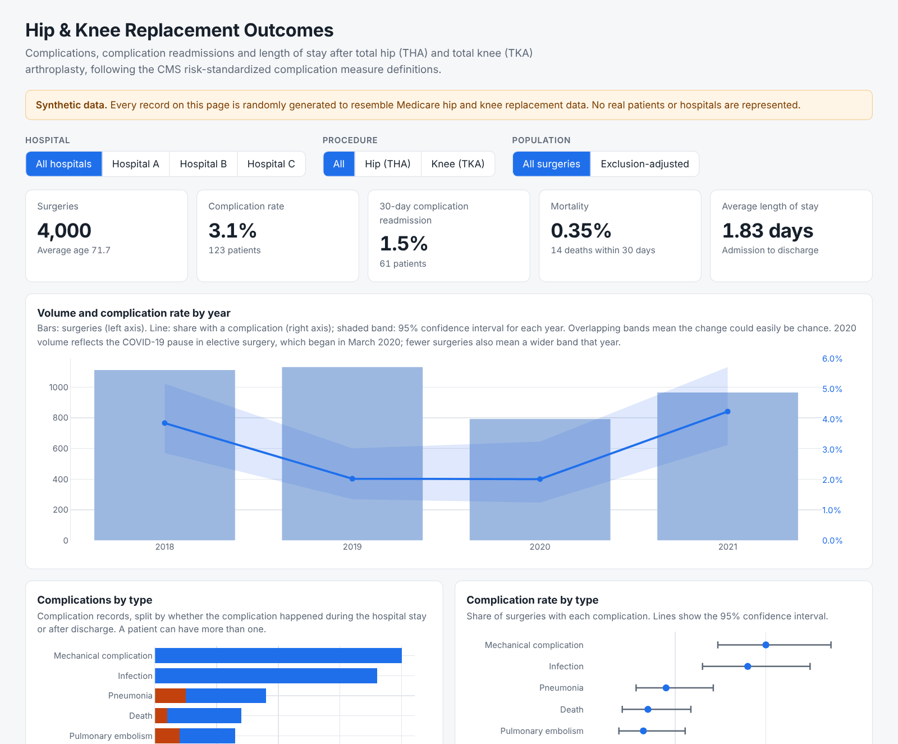

# Hip & Knee Replacement Outcomes Dashboard

[](https://github.com/Dito-84/hip-knee-replacement-outcomes-dashboard/actions/workflows/ci.yml)

An interactive dashboard of complications, complication readmissions and length of stay after **total hip arthroplasty (THA)** and **total knee arthroplasty (TKA)**, built on the CMS risk-standardized complication measure definitions.

**[Open the live dashboard →](https://dito-84.github.io/hip-knee-replacement-outcomes-dashboard/)** · also deployed on AWS: **[S3 + CloudFront version →](https://d12lu6oeqxy46k.cloudfront.net)**

> **All data in this repository is synthetic.** The original dashboard was built in Qlik Sense on de-identified hospital discharge data, which is not included here and never leaves the analyst's computer. This version is rebuilt in Python and runs on a randomly generated dataset with the same structure, so it can be shared publicly. Hospital names, counts and rates on the live page are fictional.



## Background

This is a public rebuild of the dashboard I created for the **ACE Project**, an analysis of the data behind the CMS **Risk-Standardized Complication Rate (RSCR)** following total hip and knee replacement at a regional health system. The RSCR is publicly reported and feeds into CMS quality programs and reimbursement, so understanding what drives it matters both clinically and financially.

The goal was to help clinical and administrative decision-makers pinpoint the **procedures, patient groups and hospitals with the highest complication risk**, so they could target protocol changes and preventive measures where they would have the most effect.

I taught myself Qlik Sense for the project and delivered:

- **An interactive Qlik Sense application** (26 sheets, about 80 measures) covering admissions, complications by type, complication readmissions, length of stay, age and mortality, each viewable with and without CMS exclusions
- **An "Important Observations" document** interpreting the visualizations
- **An executive summary** in PowerPoint distilling the key findings for leadership
- **A 16-page formula sheet and glossary** defining every measure and term
- **An Excel workbook of 75 odds-ratio tables and 68 supporting tables** quantifying how complication risk varied across patient and procedure characteristics
- **A visualization bank** giving offline access to every chart

The original application and its patient-level data stay private. This repository rebuilds the core dashboard in Python on synthetic data, corrects two measure definitions found during the rebuild (see [How the measures are counted](#how-the-measures-are-counted)), and adds automated tests.

## What it shows

- **Headline measures:** surgeries, complication rate, 30-day complication readmission rate, mortality and average length of stay
- **Trends by year,** including the spring 2020 drop in elective surgery
- **Complications by type:** the eight complications in the CMS measure (mechanical complications, infection, pulmonary embolism, pneumonia, sepsis, AMI, surgical site bleeding, death), split into during the stay and after discharge, with the rate of each per surgery
- **Length of stay** overall and by complication status
- **Hip vs knee odds ratios** for each complication, with 95% confidence intervals
- **Hospital comparison** with 95% confidence intervals, so small hospitals aren't over-read, plus an observed-vs-expected ratio adjusted for age group and procedure
- **Complication rate by age group,** length of stay and time from discharge to readmission

Filter by hospital, by procedure (hip or knee), and by population: all surgeries, or exclusion-adjusted (removing stays excluded from the CMS measure and complications flagged as COVID-19 related).

## How the measures are counted

Rebuilding the dashboard surfaced two issues in the original Qlik measures, both fixed here:

1. **Rates are per surgery, not per row.** A patient with two complications appears on two records. The original measures counted records, which inflated the denominator and understated every rate. Records are now collapsed to one row per index stay first ([`outcomes/metrics.py`](outcomes/metrics.py)).
2. **Readmissions are labelled correctly.** The data only records readmissions *for a complication*, so the measure is "30-day complication readmission", not the CMS all-cause readmission rate.

A later review of the original formulas found four more errors in individual Qlik measures: knee rates with a hip denominator, an exclusion-adjusted mortality rate that applied exclusions to the denominator only, age calculated at discharge instead of admission, and age bands with gaps. None carried over, because the rebuild computes every rate from one filtered set of stays. Each has a test with a small made-up case.

The rates are observed, not risk-standardized like the published CMS RSCR, which needs patient risk factors from Medicare claims that this data doesn't have. For hospital comparisons, an **observed-vs-expected ratio** adjusts for age group and procedure, the two risk factors the data does have. The **[measure crosswalk](docs/measure-crosswalk.md)** maps each measure to its CMS definition and its Python implementation, and the **[glossary](docs/glossary.md)** defines every term in plain language.

## Project structure

| Path | Purpose |
|---|---|
| `outcomes/schema.py` | Column definitions; matches the original export's headers even with line breaks |
| `outcomes/load.py` | Reads CSV or Excel, finds the header row, cleans dates and Yes/No fields |
| `outcomes/metrics.py` | Collapses records to stays and computes every measure for each filter combination |
| `outcomes/synthetic.py` | Generates the synthetic dataset (seeded, reproducible) |
| `dashboard/template.html` | The dashboard page (Plotly.js), filled with precomputed data at build time |
| `build.py` | Builds a single self-contained `index.html` |
| `tests/` | pytest suite: header matching, stay-level counting, 30-day window, filters, original-formula errors, O/E, odds ratios, synthetic data |
| `docs/measure-crosswalk.md` | Each measure against its CMS definition and Python implementation |
| `docs/glossary.md` | Plain-language definitions of every term on the dashboard |
| `outcomes/quality.py`, `scripts/check_data.py` | Data-quality checks to run on a real export before building |
| `scripts/check_no_real_data.py` | CI check that fails if any spreadsheet or non-synthetic data file is committed |
| `infra/` | AWS hosting as code: S3 + CloudFront site, GitHub OIDC deploy role, data-check Lambda ([details](infra/README.md)) |

## Run it locally

```bash
pip install -r requirements.txt
python build.py            # builds _site/index.html from the synthetic data
open _site/index.html
```

Run the tests with `pip install pytest && pytest`. Regenerate the synthetic data with `python -m outcomes.synthetic`.

## Using your own data

The loader accepts the original discharge-level export (CSV or Excel) with the standard columns: Hospital, Beneficiary DOB, Admission/Discharge Date of Index Stay, Number of THAs/TKAs Performed, Patient Had a Complication, Excluded, Complication, and so on. Keep real data in the `private/` folder, which git ignores:

```bash
mkdir private
cp ~/Downloads/<your file>.xlsx private/
python build.py --data private/<your file>.xlsx --out private/site
open private/site/index.html
```

### Check the file first

Before building from a real export, check it for problems that would quietly distort the measures:

```bash
python scripts/check_data.py private/<your file>.xlsx
```

It checks for discharges before admissions, readmissions dated before discharge, implausible ages, missing birth dates, records with no procedure, unnamed complications, and duplicate rows that aren't flagged as additional complication records. It exits with an error if any finding would make the measures wrong.

With [dstoolkit](https://github.com/Dito-84/dstoolkit) installed (`pip install -r requirements-optional.txt`), it also writes a full profile of every column to `private/data_check.html`. Blank complication, readmission and death fields mean "didn't happen" in this data, so the profile is told not to suggest filling or dropping them. The report contains record-level details: it's only ever written inside `private/`, and it should stay on your computer.

`build.py` refuses to write a build of real data anywhere except `private/` or outside the repository, and CI rejects any committed spreadsheet, so real results can't be published by accident. **Never commit patient data or screenshots of it.**

## AWS hosting

[`infra/`](infra/README.md) defines the [AWS version of this site](https://d12lu6oeqxy46k.cloudfront.net) in AWS CDK (Python):
- A private S3 bucket served through CloudFront, deployed from GitHub Actions through OIDC, so no AWS keys are stored in GitHub.
- An S3-triggered Lambda that runs the data-quality checks on an uploaded file and emails a summary.

It includes least-privilege IAM, automated cdk-nag security checks in CI, and a budget alert. Its README explains the design choices and what would change for real patient data.

## Synthetic data

`outcomes/synthetic.py` generates 4,000 fictional surgeries across three fictional hospitals (2018–2021). Volumes and rates follow published national patterns for Medicare hip and knee replacement: a complication rate around 3%, length of stay falling each year, and the 2020 elective surgery pause. Complications during the hospital stay add two days to the stay. No values are derived from real patient records. Year-to-year swings in the charts are random noise, not findings.

## Built with

Python (pandas, NumPy), Plotly.js, pytest, GitHub Actions and GitHub Pages; on AWS, CDK, S3, CloudFront, Lambda, SNS and IAM (OIDC).
