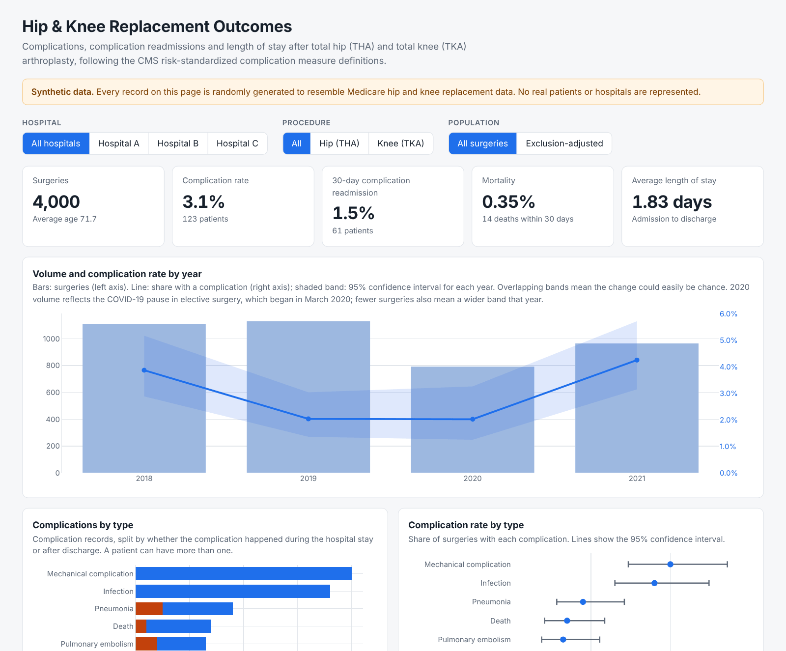
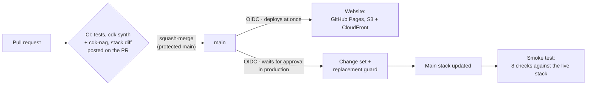
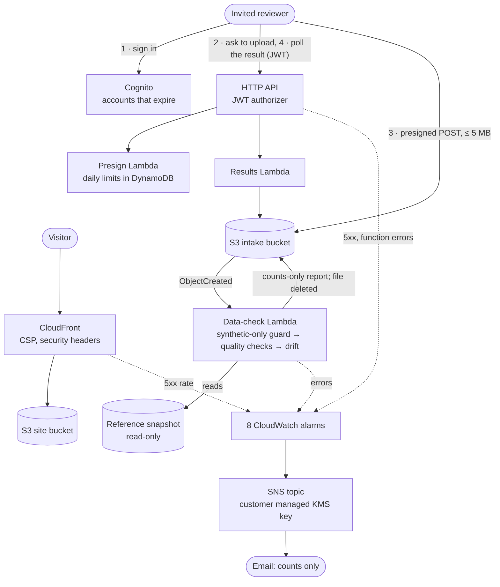
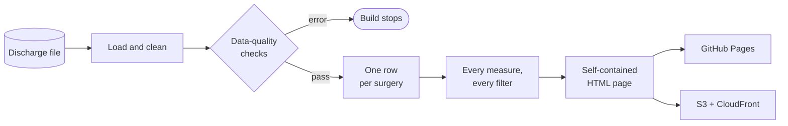

# Hip & Knee Replacement Outcomes Dashboard

[](https://github.com/Dito-84/hip-knee-replacement-outcomes-dashboard/actions/workflows/ci.yml)

An interactive dashboard of complications, complication readmissions and length of stay after **total hip arthroplasty (THA)** and **total knee arthroplasty (TKA)**, built on the CMS risk-standardized complication measure definitions.

**[Open the live dashboard →](https://dito-84.github.io/hip-knee-replacement-outcomes-dashboard/)** · also deployed on AWS: **[S3 + CloudFront version →](https://d12lu6oeqxy46k.cloudfront.net)**

> **All data in this repository is synthetic.** The original dashboard was built in Qlik Sense on de-identified hospital discharge data, which is not included here and never leaves the analyst's computer. This version is rebuilt in Python and runs on a randomly generated dataset with the same structure, so it can be shared publicly. Hospital names, counts and rates on the live page are fictional.

## At a glance

- **What it is:** a rebuild, in Python, of a hospital quality dashboard I built during an internship. It covers complications, readmissions and length of stay after hip and knee replacement, measured against the CMS complication measure.
- **What the rebuild found:** six issues in the original measures, including counting records instead of surgeries, which overstated the complication rate. Each now has a test. The **[case study](docs/case-study.md)** tells the story, including how much data a hospital comparison actually needs to detect a difference, and the AWS architecture decisions behind the data check and authenticated uploads, with their trade-offs and costs. The **[Well-Architected review](docs/well-architected.md)** goes through all six pillars, including what the first deploy taught me and a known trade-off I chose to phase.
- **How it's built:** every measure is computed ahead of time by a tested Python package (more than 100 tests plus a slow simulation check, a 90% coverage gate in CI, pinned dependencies, linted with ruff; the AWS code has its own test suite). The page is one HTML file with a Content-Security-Policy and an integrity-checked chart library, deployed to GitHub Pages and to AWS (S3 + CloudFront, defined in CDK, deployed through OIDC, security-checked by cdk-nag).
- **How it treats data:** synthetic data only in public. Real builds can only be written to a git-ignored folder, every build stops on data errors, and small counts can be hidden to meet the CMS rule.



## For reviewers: a five-minute tour

1. **[The live dashboard](https://dito-84.github.io/hip-knee-replacement-outcomes-dashboard/)** (1 minute). Switch to one hospital, then to knee only. Every rate carries an interval, and hospitals are compared on a funnel plot rather than ranked, because at about 3% a real difference takes thousands of surgeries to detect.
2. **[How the measures are counted](#how-the-measures-are-counted)** and the **[measure crosswalk](docs/measure-crosswalk.md)** (1 minute): what the rebuild found in the original measures, and each measure against its public CMS definition. Every fix has a test with a small made-up case where the right answer is known, as in [`tests/test_original_formula_errors.py`](tests/test_original_formula_errors.py) and [`tests/test_messy_exports.py`](tests/test_messy_exports.py).
3. **The two diagrams below** (1 minute): how a change reaches production, and what runs on AWS.
4. **[The deploy pipeline](.github/workflows/deploy-stack.yml)** (1 minute): no stored AWS keys, an approval gate, a change set checked by a [replacement guard](scripts/check_change_set.py) before it runs, and a [smoke test](scripts/smoke_upload.py) against the live stack after. A pull request that changes the stacks gets its template diff as a comment, scrubbed of account IDs ([example](https://github.com/Dito-84/hip-knee-replacement-outcomes-dashboard/pull/45)).
5. **[The Well-Architected review](docs/well-architected.md)** (1 minute): the design against all six pillars, the incidents and what each taught, and the trade-off I chose to phase rather than rush.

The upload demo is by invitation, with a personal, time-limited account: ask me for one.

## How a change ships

Every change goes through a pull request, CI, and a squash-merge into a protected `main`. The website deploys at once; a change to the AWS stack waits for my approval, then runs as a CloudFormation change set that a guard checks before anything changes.



## What runs on AWS



All of it costs about **$1 a month** at demo volume, nearly all of it the KMS key the alerts need; everything else fits in free tiers. Details, with the reasoning for each choice: [infra/README.md](infra/README.md).

## Key decisions

| Decision | Instead of | Why | Trade-off |
|---|---|---|---|
| Rates per surgery (records collapsed to one row per stay) | Per record, as the original did | A patient with two complications isn't two surgeries | The data has no patient ID, so a stay is keyed by hospital, birth date and dates; a quality check catches records that don't match |
| Observed rates, plus observed-vs-expected by age group and procedure | Imitating the CMS risk-standardized rate | The data has none of the Medicare risk factors the CMS model uses | Not comparable with published CMS rates, and labeled so |
| A static page with every measure precomputed | A BI tool or an app server | Nothing to run or patch; serves from a CDN for pennies | Filters are limited to the combinations computed at build time |
| Lambda as a zip package (183 MB) | A container image | No Docker in the pipeline, and the deploy Mac is Intel while Lambda runs ARM64 | 250 MB ceiling; a heavier library would need images built on an ARM64 runner |
| Cognito accounts and a JWT-authorized HTTP API | IAM users or Identity Center | Reviewers never become AWS principals | HTTP APIs can't use WAF; throttling and daily limits in DynamoDB stand in |
| Presigned POST | Presigned PUT | S3 itself enforces the 5 MB limit and the exact key | A form upload instead of a plain PUT |
| Change sets with a replacement guard, behind an approval | `cdk deploy` | See exactly what CloudFormation will do before it runs | CDK's bootstrap still gives CloudFormation admin rights; scoping it is phased ([why](docs/well-architected.md)) |
| Drift alerts gated on adjusted p < 0.01 | A PSI threshold alone | Sparse columns crossed PSI 0.25 by chance | Less sensitive on very small batches |
| A customer managed KMS key for the alert topic | The AWS managed `alias/aws/sns` key | CloudWatch alarms can't publish to a topic using that key | About $1 a month, nearly the whole bill |

## How the dashboard is built



## Background

This is a public rebuild of the dashboard I created for the **ACE Project**, an analysis of the data behind the CMS **Risk-Standardized Complication Rate (RSCR)** following total hip and knee replacement at a regional health system. The RSCR is publicly reported and feeds into CMS quality programs and reimbursement, so understanding what drives it matters both clinically and financially.

The goal was to help clinical and administrative decision-makers pinpoint the **procedures, patient groups and hospitals with the highest complication risk**, so they could target protocol changes and preventive measures where they would have the most effect.

I taught myself Qlik Sense for the project and delivered:

- **An interactive Qlik Sense application** (26 sheets, about 80 measures) covering admissions, complications by type, complication readmissions, length of stay, age and mortality, each viewable with and without CMS exclusions
- **An "Important Observations" document** interpreting the visualizations
- **An executive summary** in PowerPoint distilling the key findings for leadership
- **A 16-page formula sheet and glossary** defining every measure and term
- **An Excel workbook of 75 odds-ratio tables and 68 supporting tables** quantifying how complication risk varied across patient and procedure characteristics
- **A visualization bank** giving offline access to every chart

The original application and its patient-level data stay private. This repository rebuilds the core dashboard in Python on synthetic data, corrects two measure definitions found during the rebuild (see [How the measures are counted](#how-the-measures-are-counted)), and adds automated tests.

## What it shows

- **Headline measures:** surgeries, complication rate, 30-day complication readmission rate, mortality and average length of stay
- **Trends by year,** including the spring 2020 drop in elective surgery, with a 95% confidence band on each year's rate
- **Complications by type:** the eight complications in the CMS measure (mechanical complications, infection, pulmonary embolism, pneumonia, sepsis, AMI, surgical site bleeding, death), split into during the stay and after discharge, with the rate of each per surgery
- **Length of stay** overall and by complication status
- **Hip vs knee odds ratios** for each complication, unadjusted and adjusted for age group (Mantel-Haenszel), with 95% confidence intervals
- **Hospital comparison** as a funnel plot (rate against volume, with exact 95% and 99.8% control limits), plus an observed-vs-expected ratio adjusted for age group and procedure, and a table with 95% confidence intervals
- **Complication rate by age group,** length of stay and time from discharge to readmission

Filter by hospital, by procedure (hip or knee), and by population: all surgeries, or exclusion-adjusted (removing stays excluded from the CMS measure and complications flagged as COVID-19 related).

## How the measures are counted

Rebuilding the dashboard surfaced two issues in the original Qlik measures, both fixed here:

1. **Rates are per surgery, not per row.** A patient with two complications appears on two records, and the original measures counted records. For the complication and readmission rates the extra records add to both the top and the bottom of the fraction, which overstates the rate (on the synthetic data, a 3.41% complication rate instead of 3.08%). For rates like mortality they only add to the bottom, which understates it slightly. Records are now collapsed to one row per index stay first ([`outcomes/metrics.py`](outcomes/metrics.py)).
2. **Readmissions are labelled correctly.** The data only records readmissions *for a complication*, so the measure is "30-day complication readmission", not the CMS all-cause readmission rate.

A later review of the original formulas found four more errors in individual Qlik measures: knee rates with a hip denominator, an exclusion-adjusted mortality rate that applied exclusions to the denominator only, age calculated at discharge instead of admission, and age bands with gaps. None carried over, because the rebuild computes every rate from one filtered set of stays. Each has a test with a small made-up case.

The rates are observed, not risk-standardized like the published CMS RSCR, which needs patient risk factors from Medicare claims that this data doesn't have. For hospital comparisons, an **observed-vs-expected ratio** adjusts for age group and procedure, the two risk factors the data does have. The **[measure crosswalk](docs/measure-crosswalk.md)** maps each measure to its CMS definition and its Python implementation, and the **[glossary](docs/glossary.md)** defines every term in plain language.

## Project structure

| Path | Purpose |
|---|---|
| `outcomes/schema.py` | Column definitions; matches the original export's headers even with line breaks |
| `outcomes/load.py` | Reads CSV or Excel, finds the header row, cleans dates and Yes/No fields |
| `outcomes/metrics.py` | Collapses records to stays and computes every measure for each filter combination |
| `outcomes/stats.py` | Statistical helpers: Wilson and Poisson intervals, odds ratios, Mantel-Haenszel |
| `outcomes/synthetic.py` | Generates the synthetic dataset (seeded, reproducible), with a `Synthetic Marker` column on every row |
| `outcomes/synthetic_guard.py` | Refuses files that aren't marked synthetic data: used by CI and the AWS data check |
| `dashboard/template.html` | The dashboard page (Plotly.js), filled with precomputed data at build time |
| `build.py` | Builds a single self-contained `index.html` |
| `tests/` | pytest suite, one file per area: loading, measures, original-formula errors, comparisons, statistics (including simulated interval coverage), suppression, build, synthetic data, quality checks |
| `docs/measure-crosswalk.md` | Each measure against its CMS definition and Python implementation |
| `docs/case-study.md` | The analytical story: what the rebuild found, how the methods were checked, how much data a comparison needs, and the AWS architecture decisions |
| `docs/well-architected.md` | The AWS side against the six Well-Architected pillars: what's in place, trade-offs, lessons, next steps |
| `docs/glossary.md` | Plain-language definitions of every term on the dashboard |
| `outcomes/suppression.py` | Optional small-cell suppression (counts of 1 to 10) for builds that will be shared |
| `outcomes/quality.py`, `scripts/check_data.py` | Data-quality checks to run on a real export before building |
| `scripts/check_no_real_data.py` | CI check that fails if any spreadsheet or non-synthetic data file is committed, or any CSV lacks the synthetic marker |
| `scripts/check_cdn_integrity.py` | CI check that the chart library on the CDN still matches the integrity hash in the page |
| `infra/` | AWS hosting as code: S3 + CloudFront site, GitHub OIDC deploy role, data-check Lambda, authenticated uploads ([details](infra/README.md)) |

## Run it locally

```bash
pip install -r requirements.txt
python build.py            # builds _site/index.html from the synthetic data
open _site/index.html
```

For development, `pip install -r requirements-dev.txt`, then `ruff check .` and `pytest --cov` (CI fails below 90% coverage). `pytest -m slow --no-cov` runs the slower end-to-end check of interval coverage across 30 generated datasets (about 20 seconds); CI runs it too. Regenerate the synthetic data with `python -m outcomes.synthetic`.

Dependencies are pinned in `requirements.txt` and `requirements-dev.txt`, generated from `pyproject.toml` with `uv pip compile` (the command is at the top of each file). Dependabot proposes updates monthly, and CI tests them before anything is merged.

## Using your own data

The loader accepts the original discharge-level export (CSV or Excel) with the standard columns: Hospital, Beneficiary DOB, Admission/Discharge Date of Index Stay, Number of THAs/TKAs Performed, Patient Had a Complication, Excluded, Complication, and so on. Keep real data in the `private/` folder, which git ignores:

```bash
mkdir private
cp ~/Downloads/<your file>.xlsx private/
python build.py --data private/<your file>.xlsx --out private/site
open private/site/index.html
```

### Hide small counts before sharing

CMS doesn't allow publishing counts of 1 to 10 people. Before sharing a build of real data, hide them:

```bash
python build.py --data private/<your file>.xlsx --out private/site --suppress-under 11
```

Every count from 1 to 10, and every rate, interval, average or ratio computed from one, is shown as "–". Zero is shown. This is primary suppression only: a hidden count can sometimes be worked out by subtraction (a total minus the other cells), so review the page before sharing it. It's off by default, because the synthetic data has no real people in it.

### Check the file first

Before building from a real export, check it for problems that would quietly distort the measures:

```bash
python scripts/check_data.py private/<your file>.xlsx
```

It checks for discharges before admissions, readmissions dated before discharge, implausible ages, missing birth dates, records with no procedure, unnamed complications, and duplicate rows that aren't flagged as additional complication records. It also refuses to guess: a date that isn't month/day/year or year-month-day, or a Yes/No field that isn't Yes or No (a blank `Excluded`, say), is an error, because reading it as blank or No would quietly change a rate. So is an additional complication record that matches no stay, which would otherwise be counted as an extra surgery. It exits with an error if any finding would make the measures wrong. `build.py` runs the same checks on every build and stops on an error; `--skip-checks` overrides that once you've reviewed the findings.

With [dstoolkit](https://github.com/Dito-84/dstoolkit) installed (`pip install -r requirements-optional.txt`), it also writes a full profile of every column to `private/data_check.html`. Blank complication, readmission and death fields mean "didn't happen" in this data, so the profile is told not to suggest filling or dropping them. The report contains record-level details: it's only ever written inside `private/`, and it should stay on your computer.

`build.py` refuses to write a build of real data anywhere except `private/` or outside the repository, and CI rejects any committed spreadsheet, so real results can't be published by accident. **Never commit patient data or screenshots of it.**

## AWS hosting

[`infra/`](infra/README.md) defines the [AWS version of this site](https://d12lu6oeqxy46k.cloudfront.net) in AWS CDK (Python):
- A private S3 bucket served through CloudFront, deployed from GitHub Actions through OIDC, so no AWS keys are stored in GitHub.
- Deployed from CI: GitHub OIDC roles with no stored keys, an approval gate in a `production` environment, a CloudFormation change set checked by a replacement guard, and a smoke test of the live stack after every deploy. The CI roles live in a second stack that only I deploy, by hand.
- An S3-triggered Lambda that runs the data-quality checks on an uploaded file, checks it for drift against a read-only reference snapshot (type changes, distribution shift, more blanks, new codes, added or removed columns), and emails a counts-only summary. CloudWatch alarms and a dead-letter queue make sure a failed check is reported rather than silent. A synthetic-only guard rejects and deletes any file without the synthetic marker.
- Authenticated uploads for invited reviewers: Cognito sign-in (admin-created, time-limited accounts), an API Gateway HTTP API with a JWT authorizer that issues presigned S3 POSTs, daily upload limits in DynamoDB, and a page that shows the check's counts-only result. Four sample batches show each outcome. Real patient data is never uploaded, and the page and the Lambda both refuse files that aren't marked synthetic. Expired accounts are deleted automatically a week after they end.

It includes least-privilege IAM, automated cdk-nag security checks in CI, and a budget alert. Its README explains the design choices and what would change for real patient data.

## Synthetic data

`outcomes/synthetic.py` generates 4,000 fictional surgeries across three fictional hospitals (2018–2021). Volumes and rates follow published national patterns for Medicare hip and knee replacement: a complication rate around 3%, length of stay falling each year, and the 2020 elective surgery pause (modeled on the real COVID-19 pause that began in March 2020: about 88% fewer surgeries in April and May, about 45% fewer in March and June, and lower volume after that). The synthetic data has no COVID effect on complication rates, so none is claimed. Complications during the hospital stay add two days to the stay, and patients under 65 are flagged excluded, as in the CMS 65+ cohort. No values are derived from real patient records. Year-to-year swings in the charts are random noise, not findings. The generator has no year effect, yet with this seed the 2019 and 2021 confidence bands barely overlap. Across other seeds the yearly rates average 2.6% to 3.1% with no pattern, so it's a useful reminder that one interval in twenty misses by chance.

## Built with

Python (pandas, NumPy, SciPy), Plotly.js, pytest, ruff, uv, GitHub Actions and GitHub Pages; on AWS, CDK, CloudFormation, S3, CloudFront, Lambda, API Gateway, Cognito, DynamoDB, SQS, SNS, KMS, CloudWatch, EventBridge and IAM (OIDC).

## License

The code is [MIT](LICENSE)-licensed. The data in this repository is synthetic, generated by `outcomes/synthetic.py`.
