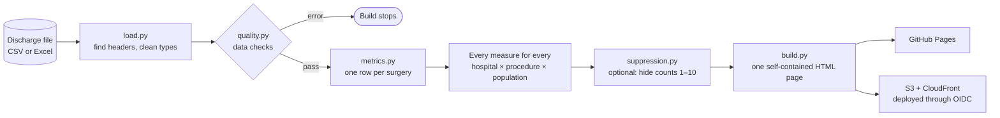

# Case study: rebuilding a hospital outcomes dashboard

What I learned rebuilding my internship's hip and knee replacement dashboard in Python, and the decisions behind it. Every number here comes from the synthetic dataset in this repository. None comes from real patient data.

## The problem

During my internship I built a Qlik Sense dashboard on the data behind the CMS **Risk-Standardized Complication Rate (RSCR)** after total hip (THA) and total knee (TKA) replacement. The RSCR is publicly reported and affects reimbursement, so the question was practical: *which procedures, patient groups and hospitals carry the most complication risk, and where would changes to protocols help most?*

The original app and its data are private. To share the work, I rebuilt the core dashboard in Python on a synthetic dataset with the same structure: 4,000 fictional surgeries at three fictional hospitals, 2018 to 2021. Rebuilding every measure from scratch, with a test for each, turned up problems in the original that I hadn't seen while building it.

## How it fits together

Every measure is computed in Python ahead of time for all 24 filter combinations, so the page is static: no server, no database, nothing to log in to. The [infrastructure README](../infra/README.md) covers the AWS side.

## Finding 1: count surgeries, not rows

The source file has one row per *complication*, not per surgery. A patient with two complications has two rows. The original measures counted rows, and that distorts every rate, in different directions:

| Rate (synthetic data) | Counting rows | Counting surgeries |
|---|---|---|
| Complication rate | 137 ÷ 4,014 = **3.41%** | 123 ÷ 4,000 = **3.08%** |
| 30-day complication readmission | 68 ÷ 4,014 = **1.69%** | 61 ÷ 4,000 = **1.53%** |
| Mortality | 14 ÷ 4,014 = **0.349%** | 14 ÷ 4,000 = **0.350%** |

For complications and readmissions, the extra rows land in both the top and the bottom of the fraction, which pushes the rate up. For mortality they only add to the bottom, which pulls it down slightly. The rebuild collapses rows to one per surgery before computing anything.

A note on my own mistake: I first described this correction as "the denominator was inflated, so every rate came out low". Computing it showed the opposite for the headline rate, and I corrected the README. Checking a claim against the data, even one that sounds obviously right, is the habit this project taught me most.

## Finding 2: "readmission" meant something narrower

The only readmission date in the file is the admission date for a *complication*. So the measure is a 30-day **complication** readmission rate, not the CMS all-cause readmission rate, and the dashboard labels it that way.

## Finding 3: four formula errors, prevented by design

Reviewing the original formulas found four more errors:
- knee-only rates divided by hip admissions
- an exclusion-adjusted mortality rate that applied the exclusions to the denominator only
- age calculated at discharge instead of admission
- age bands with gaps

They had a common cause. The original had a separate hand-written formula for each combination of measure, procedure and population, about 120 in all, and each one was a chance to mistype a filter. The rebuild filters the surgeries once, then computes every rate from that one set, so the top and bottom of a fraction can't disagree. Each error now has a test with a small made-up case where the right answer is known (see the [measure crosswalk](measure-crosswalk.md)).

## Observed rates, and an honest comparison

The CMS rate is *risk-standardized*: a hierarchical model adjusts each hospital for its patients' risk factors, drawn from a year of earlier Medicare claims. This data has none of those, so the dashboard shows **observed** rates and says so on the page.

To compare hospitals more fairly than raw rates allow, it adds an **observed vs expected (O/E)** ratio, adjusted for the two risk factors the data does have: age group and procedure. Because the data is synthetic, I could check it against the truth. The generator sets each hospital's complication risk directly:

| Hospital | Surgeries | Observed | Expected | O/E (95% interval) | True relative risk |
|---|---|---|---|---|---|
| A | 661 | 23 | 20.4 | 1.13 (0.71–1.69) | 1.19 |
| B | 1,749 | 55 | 54.0 | 1.02 (0.77–1.33) | 0.92 |
| C | 1,590 | 45 | 48.5 | 0.93 (0.68–1.24) | 1.02 |

Every interval contains the true value, so the method works. But the point estimates rank B and C the wrong way round. That isn't a bug: about 120 complications is too few to tell a 10% difference from noise, so the page shows intervals and never a league table.

## How much data a comparison needs

That raised the obvious question: how big a difference *could* this data detect? At a complication rate of about 3%, comparing two groups with 80% power at the usual 5% significance level needs:

| Difference to detect | Surgeries needed per group |
|---|---|
| 20% higher risk (3.0% vs 3.6%) | about 13,900 |
| 50% higher (3.0% vs 4.5%) | about 2,500 |
| Twice the risk (3.0% vs 6.0%) | about 750 |

Hospital A is generated with about 20% higher risk than average, but it has 661 surgeries, roughly 165 a year. Compared with the other two hospitals combined, the dashboard has only a **14% chance** of detecting a 20% difference. It reaches 80% only once A's risk is about 1.8 times the others'.

This changes how the dashboard should be read. With only a few hundred surgeries a year, a hospital's observed rate is mostly noise. It's why CMS pools three years of data and uses a model that pulls small hospitals toward the national rate. The dashboard can spot a hospital that's dramatically different, and nothing subtler. The right response is to show uncertainty everywhere, which is why every rate on the page has an interval.

## Treating the data as sensitive by default

Although the public version is synthetic, the code is built to be run on a real export, so the safeguards are in the code, not in good intentions:
- **The build refuses to publish real data.** A build of any file other than the synthetic one can only be written to a git-ignored `private/` folder, and CI rejects any committed spreadsheet.
- **The build stops on bad data.** Every build runs the quality checks first (discharges before admissions, readmissions dated before discharge, implausible ages, unflagged duplicate rows) and stops if one would make the measures wrong.
- **Small counts can be hidden.** `--suppress-under 11` applies the CMS rule against publishing counts of 1 to 10, along with anything computed from them.
- **The AWS data check reports counts only.** The S3-triggered Lambda emails which checks failed, how many rows, and which columns drifted and by how much, never values from the file. Tests check this, including for a file with relabelled and new values.

## The synthetic data

The generator is seeded, so every run produces the same 4,000 surgeries. Volumes and rates follow published national Medicare patterns: about 3% complications, length of stay falling each year, and the 2020 pause in elective surgery. It also builds in two relationships a clinical reviewer would expect: complications during the stay lengthen it, and patients under 65 are outside the CMS cohort.

Some patterns are chance. With this seed, the 2019 and 2021 complication rates barely overlap, although the generator has no year effect. Across 12 other seeds the yearly rates average 2.6% to 3.1% with no pattern. I kept the seed rather than pick one that hides the gap, because one 95% interval in twenty misses by chance, and that's worth seeing.

## Limitations

- **No patient identifier.** A surgery is identified by hospital, birth date and stay dates, so two patients with identical values would merge. That's rare, but possible.
- **Adjustment is limited to what's in the file.** O/E and the age-adjusted odds ratios adjust only for age and procedure, so they can't stand in for the CMS model.
- **The O/E reference includes the hospital being compared**, which pulls the largest hospital slightly toward 1.0 and makes the O/E interval conservative (see below).
- **Many intervals on one page.** About 1 in 20 will exclude the true value by chance alone.

## Checking the intervals themselves

Every rate on the page has a 95% interval, so it's worth asking whether they really contain the truth 95% of the time. Synthetic data makes this testable, because the truth is known. The tests draw thousands of samples from a known rate and count how often each interval contains it:

| Interval | Used for | Contains the truth |
|---|---|---|
| Wilson | Rates (complications, readmissions, by type, by year) | 95.3% |
| Byar (Poisson) | Observed vs expected | 95.4% |
| Woolf | Odds ratios | 95.7% |

A slower test runs the whole pipeline on 30 generated datasets and checks each hospital's O/E interval against its true risk from the generator. It contained the truth in **all 90 cases**. Getting 90 of 90 by chance at a true 95% would happen less than 1% of the time, so the O/E interval is *conservative*: wider than it needs to be. The reason is the design choice noted under limitations: each hospital is part of its own reference group, so its observed and expected counts move together, while the interval assumes the expected count is fixed. Too wide is the safe direction, since it won't flag a hospital wrongly, but it means O/E is slow to flag one. The test fails if coverage ever drops below 95%.

## Comparing hospitals with a funnel plot

The hospital chart is a **funnel plot**: each hospital's rate against its number of surgeries, with control limits around the rate for all hospitals combined. It's the standard way to compare providers in healthcare quality work. The limits are exact binomial limits rather than the usual normal approximation, which is poor at a 3% rate. At about 660 surgeries, Hospital A's size, the 95% limits run from about 1.9% to 4.5%. A's observed 3.5% sits well inside, which is the sample-size finding above made visible.

## Architecture decisions on AWS

The AWS side started as a static site and a Lambda that checks uploaded files. Adding a drift check, and then alerts for when the check itself fails, forced a series of trade-offs. Each one had numbers behind it.

### Packaging: a zip, after fixing the library instead of the platform

The drift check uses `compare()` from my own library, [dstoolkit](https://github.com/Dito-84/dstoolkit), which needs SciPy for its significance tests. Lambda allows 250 MB unzipped, **counting the function and all its layers together**, so a layer doesn't add space. I measured the package for Lambda's platform (Linux, ARM64):

| Package | Unzipped |
|---|---|
| Before (pandas, NumPy) | 81 MB |
| + SciPy | 182 MB |
| + matplotlib, which `import dstoolkit` loaded for plotting | 259 MB |

A container image (up to 10 GB) would have fit. But it would have added Docker to every deploy, and on my Intel Mac it would have built an ARM64 image under emulation. The real problem was that a library loaded a plotting package it didn't need. So I fixed that in dstoolkit 0.15.1: plotting now imports matplotlib only when it draws, and a test keeps it that way. The Lambda installs dstoolkit without matplotlib, at 183 MB. That leaves less room than an image, so the next step is written down: if the function ever needs something large, such as scikit-learn to score a model, build a container image in CI on an ARM64 runner.

### Alerting on drift: big *and* unlikely to be chance

`compare()` rates each column's change by the population stability index (PSI): 0.25 or more is "major". My first rule was "alert on any major change". Testing it on fresh synthetic batches with no real drift showed it would email on most uploads. Columns that are more than 96% blank, such as complication type and death date, hold only a few dozen to a hundred or so values, and their PSI crosses 0.25 by chance.

So a shift or new codes alert only when they're major **and** the adjusted p-value is under 0.01. Removed columns, type changes and blanks moving 10 points or more always alert, because they're exact facts about the file with no sampling noise. Across 120 stable batches of 100 to 4,000 surgeries, the rule raised no alerts. It still catches each kind of drift in the tests: counts sent as "Yes"/"No", a hospital relabelled, a new code, and a column suddenly 20% blank. The rule lives in one small file, so changing it is a one-line review.

The comparison reads each file as delivered, before the dashboard's cleaning. Cleaning converts a count of "Yes" to 0, which would hide exactly the kind of change the check is for.

### The reference can't be overwritten by what it judges

New uploads are compared with a reference copy of the synthetic dataset. If an upload could replace the reference, one bad file would redefine "normal". The reference therefore has its own versioned bucket, protected two ways:
- **The function's role** can read exactly one object there, with no wildcard.
- **The bucket's policy** refuses writes and deletes from the function, so a permission added later by mistake still couldn't change it.

The reference changes only when I run a script that publishes the committed file, and only if it matches git exactly. Each report names the reference version it was compared with.

### A broken check is never silent

S3 calls the Lambda asynchronously. If the function crashes, no report email goes out, and after Lambda's retries the event is dropped, so a broken check looks exactly like a quiet week. Now, after two retries, the event goes to a dead-letter queue (kept 14 days), and two CloudWatch alarms email me: one on any error, one when an upload gives up.

Lambda can also send its failure records straight to email. I didn't use that: the records include the error message, which could quote a value from the file, and the alerts are meant to carry counts only. An alarm email says only which alarm fired.

### A gotcha: the default encryption key blocks alarms

The alert topic was encrypted with AWS's managed key for SNS. CloudWatch alarms **can't** publish to a topic encrypted with that key, and its policy can't be edited, so the alarms would have fired without sending anything. I found this in AWS's documentation before deploying, rather than after a missed alert. The topic now uses a customer managed key (rotated yearly, about $1 a month), which CloudWatch may use only for this account. The topic accepts alarm messages only from these two alarms. The alternative was a separate unencrypted topic for alarms. It was free, but it would have weakened an otherwise consistent rule: everything is encrypted at rest. After deploying, I tested it by forcing an alarm and confirming the email arrived.

### Pinning a dependency so it can't change underneath you

At first the Lambda pinned dstoolkit to a git commit, not to its `v0.15.1` tag. A tag can be deleted and recreated pointing at different code, and the next deploy would ship it without anyone noticing. A commit can't change. Since then I've published dstoolkit to PyPI as `pandas-dstoolkit` (PyPI treats `dstoolkit` as too close to an unrelated `ds-toolkit`). GitHub Actions uploads each release through trusted publishing, so no upload token exists. The Lambda now pins version 0.15.2 **and its SHA-256 hash**. PyPI never lets a version's files be replaced, and pip refuses any file whose hash doesn't match, so the pin is as fixed as a commit. Deploying also no longer needs git or a local build.

### What it costs

The drift check adds a few seconds per upload, about $0.00005, at the same 1 GB of memory. The fixed cost is the alert topic's key, about $1 a month. The alarms, the queue and the reference copy fit in AWS's free tier or cost a fraction of a cent, all well within the $5 budget alert.
