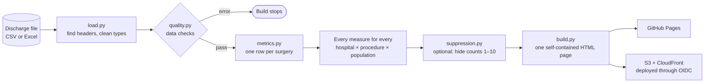

# Case study: rebuilding a hospital outcomes dashboard

What I learned rebuilding my internship's hip and knee replacement dashboard in Python, and the decisions behind it. Every number here comes from the synthetic dataset in this repository. None comes from real patient data.

## The problem

During my internship I built a Qlik Sense dashboard on the data behind the CMS **Risk-Standardized Complication Rate (RSCR)** after total hip (THA) and total knee (TKA) replacement. The RSCR is publicly reported and affects reimbursement, so the question was practical: *which procedures, patient groups and hospitals carry the most complication risk, and where would changes to protocols help most?*

The original app and its data are private. To share the work, I rebuilt the core dashboard in Python on a synthetic dataset with the same structure: 4,000 fictional surgeries at three fictional hospitals, 2018 to 2021. Rebuilding every measure from scratch, with a test for each, turned up problems in the original that I hadn't seen while building it.

## How it fits together

Every measure is computed in Python ahead of time for all 24 filter combinations, so the page is static: no server, no database, nothing to log in to. The [infrastructure README](../infra/README.md) covers the AWS side.

## Finding 1: count surgeries, not rows

The source file has one row per *complication*, not per surgery. A patient with two complications has two rows. The original measures counted rows, and that distorts every rate, in different directions:

| Rate (synthetic data) | Counting rows | Counting surgeries |
|---|---|---|
| Complication rate | 137 ÷ 4,014 = **3.41%** | 123 ÷ 4,000 = **3.08%** |
| 30-day complication readmission | 68 ÷ 4,014 = **1.69%** | 61 ÷ 4,000 = **1.53%** |
| Mortality | 14 ÷ 4,014 = **0.349%** | 14 ÷ 4,000 = **0.350%** |

For complications and readmissions, the extra rows land in both the top and the bottom of the fraction, which pushes the rate up. For mortality they only add to the bottom, which pulls it down slightly. The rebuild collapses rows to one per surgery before computing anything.

A note on my own mistake: I first described this correction as "the denominator was inflated, so every rate came out low". Computing it showed the opposite for the headline rate, and I corrected the README. Checking a claim against the data, even one that sounds obviously right, is the habit this project taught me most.

## Finding 2: "readmission" meant something narrower

The only readmission date in the file is the admission date for a *complication*. So the measure is a 30-day **complication** readmission rate, not the CMS all-cause readmission rate, and the dashboard labels it that way.

## Finding 3: four formula errors, prevented by design

Reviewing the original formulas found four more errors:
- knee-only rates divided by hip admissions
- an exclusion-adjusted mortality rate that applied the exclusions to the denominator only
- age calculated at discharge instead of admission
- age bands with gaps

They had a common cause. The original had a separate hand-written formula for each combination of measure, procedure and population, about 120 in all, and each one was a chance to mistype a filter. The rebuild filters the surgeries once, then computes every rate from that one set, so the top and bottom of a fraction can't disagree. Each error now has a test with a small made-up case where the right answer is known (see the [measure crosswalk](measure-crosswalk.md)).

## Observed rates, and an honest comparison

The CMS rate is *risk-standardized*: a hierarchical model adjusts each hospital for its patients' risk factors, drawn from a year of earlier Medicare claims. This data has none of those, so the dashboard shows **observed** rates and says so on the page.

To compare hospitals more fairly than raw rates allow, it adds an **observed vs expected (O/E)** ratio, adjusted for the two risk factors the data does have: age group and procedure. Because the data is synthetic, I could check it against the truth. The generator sets each hospital's complication risk directly:

| Hospital | Surgeries | Observed | Expected | O/E (95% interval) | True relative risk |
|---|---|---|---|---|---|
| A | 661 | 23 | 20.4 | 1.13 (0.71–1.69) | 1.19 |
| B | 1,749 | 55 | 54.0 | 1.02 (0.77–1.33) | 0.92 |
| C | 1,590 | 45 | 48.5 | 0.93 (0.68–1.24) | 1.02 |

Every interval contains the true value, so the method works. But the point estimates rank B and C the wrong way round. That isn't a bug: about 120 complications is too few to tell a 10% difference from noise, so the page shows intervals and never a league table.

## How much data a comparison needs

That raised the obvious question: how big a difference *could* this data detect? At a complication rate of about 3%, comparing two groups with 80% power at the usual 5% significance level needs:

| Difference to detect | Surgeries needed per group |
|---|---|
| 20% higher risk (3.0% vs 3.6%) | about 13,900 |
| 50% higher (3.0% vs 4.5%) | about 2,500 |
| Twice the risk (3.0% vs 6.0%) | about 750 |

Hospital A is generated with about 20% higher risk than average, but it has 661 surgeries, roughly 165 a year. Compared with the other two hospitals combined, the dashboard has only a **14% chance** of detecting a 20% difference. It reaches 80% only once A's risk is about 1.8 times the others'.

This changes how the dashboard should be read. With only a few hundred surgeries a year, a hospital's observed rate is mostly noise. It's why CMS pools three years of data and uses a model that pulls small hospitals toward the national rate. The dashboard can spot a hospital that's dramatically different, and nothing subtler. The right response is to show uncertainty everywhere, which is why every rate on the page has an interval.

## Treating the data as sensitive by default

Although the public version is synthetic, the code is built to be run on a real export, so the safeguards are in the code, not in good intentions:
- **The build refuses to publish real data.** A build of any file other than the synthetic one can only be written to a git-ignored `private/` folder, and CI rejects any committed spreadsheet.
- **The build stops on bad data.** Every build runs the quality checks first (discharges before admissions, readmissions dated before discharge, implausible ages, unflagged duplicate rows) and stops if one would make the measures wrong.
- **Small counts can be hidden.** `--suppress-under 11` applies the CMS rule against publishing counts of 1 to 10, along with anything computed from them.
- **The AWS data check reports counts only.** The S3-triggered Lambda emails which checks failed and how many rows, never values from the file. A test checks this.

## The synthetic data

The generator is seeded, so every run produces the same 4,000 surgeries. Volumes and rates follow published national Medicare patterns: about 3% complications, length of stay falling each year, and the 2020 pause in elective surgery. It also builds in two relationships a clinical reviewer would expect: complications during the stay lengthen it, and patients under 65 are outside the CMS cohort.

Some patterns are chance. With this seed, the 2019 and 2021 complication rates barely overlap, although the generator has no year effect. Across 12 other seeds the yearly rates average 2.6% to 3.1% with no pattern. I kept the seed rather than pick one that hides the gap, because one 95% interval in twenty misses by chance, and that's worth seeing.

## Limitations

- **No patient identifier.** A surgery is identified by hospital, birth date and stay dates, so two patients with identical values would merge. That's rare, but possible.
- **Adjustment is limited to what's in the file.** O/E and the age-adjusted odds ratios adjust only for age and procedure, so they can't stand in for the CMS model.
- **The O/E reference includes the hospital being compared**, which pulls the largest hospital slightly toward 1.0.
- **Many intervals on one page.** About 1 in 20 will exclude the true value by chance alone.

## What I'd do next

- A **funnel plot** for hospitals: rate against volume, with control limits that narrow as volume grows. It's the standard way to compare providers in healthcare quality work.
- A **simulation test** that generates many seeds and checks each 95% interval contains the true value about 95% of the time.
