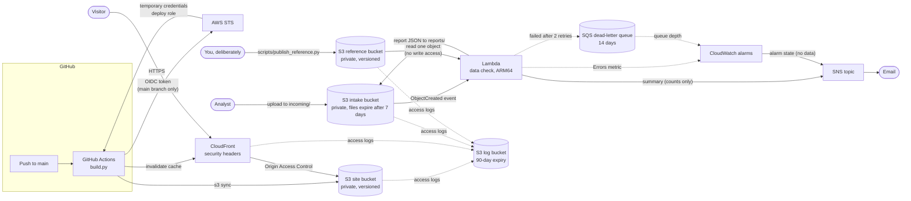

# AWS hosting

Infrastructure as code (AWS CDK, Python) that runs the dashboard on AWS:

- **Website:** S3 and CloudFront host the dashboard. GitHub Actions deploys it by signing in to AWS through OIDC, so no AWS keys are stored anywhere.
- **Data check:** uploading a discharge file to S3 triggers a Lambda function. It runs the same [data-quality checks](../outcomes/quality.py) as `scripts/check_data.py`, compares the file with a reference snapshot for **drift**, and emails the result.

The GitHub Pages site keeps working on its own. This is a second, independent way to host the dashboard.

## Architecture



## Drift check

Each upload is compared, column by column, with a reference snapshot: the committed synthetic dataset. [dstoolkit](https://github.com/Dito-84/dstoolkit)'s `compare()` reports type changes (numbers arriving as text), distribution shift (the population stability index, PSI), more or fewer blanks, new codes or relabelled categories, and added or removed columns. Both files are read as delivered (`outcomes.load.load_raw`), before the dashboard's cleaning, which would otherwise hide some of these: `load()` reads a count sent as "Yes" as 0.

**What alerts** is decided in one place, [`drift_policy.py`](lambda/data_check/drift_policy.py):

| Finding | Result |
|---|---|
| A column removed, a type change, or blanks up or down by 10 percentage points or more | Alert |
| A major shift or new codes (PSI ≥ 0.25, or new values in ≥ 5% of rows) **and** an adjusted p-value under 0.01 | Alert |
| Moderate changes, added columns, and major shifts that could be chance (p ≥ 0.01) | Logged in the report and CloudWatch, no alert |
| Shift or new values in `readmit_provider_id` | Logged: provider IDs are expected to be new each time |

The p-value condition is there because "any major status alerts" would email on most uploads. Columns that are 97–99% blank hold a few dozen values, and in batches with no real drift their PSI regularly crosses 0.25 by chance. With the condition, 120 fresh synthetic batches of 100 to 4,000 stays raised no alert, while each kind of real drift in the tests does.

**Counts only.** `compare()`'s `issues` text and `new_categories` list contain example values (a new hospital name, for instance), so [`drift.py`](lambda/data_check/drift.py) drops them before anything is written. Reports, logs and emails carry column names, statuses and numbers: PSI, adjusted p-value, blank shares and the number of new values.

**The reference** lives in its own versioned bucket. The function can read exactly one object, `reference/discharges.csv` (no wildcard), and has no write or delete permission there; the bucket policy also refuses writes from the function, in case one were ever added to its role. So an upload can never become the reference. It changes only when you run [`scripts/publish_reference.py`](../scripts/publish_reference.py), which publishes the committed synthetic CSV and nothing else, recording the git commit and SHA-256. Each report names the reference version it was compared with. The last 5 earlier versions are kept for a year. If the reference is missing, the drift check is skipped and the data check runs as before.

**Packaging.** SciPy (for the p-values) takes the package from 81 MB to 183 MB unzipped, inside Lambda's 250 MB limit, which covers the function and its layers together. A layer wouldn't raise it. dstoolkit's plotting library, matplotlib, would have pushed it to 259 MB. dstoolkit 0.15.1 imports matplotlib only when it draws, so it's installed with `--no-deps` and matplotlib is left out. A container image (up to 10 GB) was the alternative. It was rejected because it would add Docker to every deploy, and on an Intel Mac it would build the ARM64 image under emulation. If the function ever needs much more (scikit-learn to score a model, say), a container image built by GitHub Actions on an ARM64 runner is the next step.

## Design decisions

These are grouped by the four areas of the AWS Well-Architected Framework, which are also the four domains of the Solutions Architect – Associate exam.

**Secure**
- Every bucket blocks all public access, encrypts data at rest and refuses plain-HTTP requests.
- The site bucket can only be read by this one CloudFront distribution, through Origin Access Control. Visitors can't bypass the CDN.
- GitHub signs in to AWS through **OIDC**, so there are no long-lived access keys to leak or rotate. Only the `main` branch of this repository can assume the deploy role, and only for one hour at a time.
- **Least privilege, written out by hand:**
  - The deploy role can list, upload and delete files in the site bucket and clear the CloudFront cache. Nothing else.
  - The Lambda can read `incoming/`, write `reports/`, read the single reference object, publish to its topic and write its own logs. It uses no AWS managed policies.
- **Automated security review:** [cdk-nag](https://github.com/cdklabs/cdk-nag) runs the AWS Solutions rule pack on every synth and in CI. The few rules that don't apply are documented with reasons in [`nag.py`](dashboard_infra/nag.py). Any other finding fails the build.
- The data check's reports and emails contain only counts, column names and check names, never values from the file. Tests check this, including for a drifted file with relabelled and new values.
- The alert topic is encrypted with a **customer managed KMS key**, rotated yearly. The AWS managed `alias/aws/sns` key can't be used here, because CloudWatch alarms can't publish to a topic encrypted with it and its policy can't be edited. The key policy lets CloudWatch use the key only for this account, and the topic policy accepts alarm messages only from this stack's two alarms.
- Failure alerts come from CloudWatch alarms, not from Lambda's failure records. Those records include the error message and could hold a value from the file; an alarm email says only which alarm fired.
- **The page itself** carries a Content-Security-Policy (built into the HTML, so the GitHub Pages copy has it too). It allows only the page's own script, by hash, and the chart library from jsDelivr, pinned by a subresource-integrity hash that CI checks against the CDN. A tampered library or an injected script won't run.

**Reliable**
- S3 and CloudFront are managed, multi-Availability-Zone services, and there are no servers to patch.
- Site versions are kept for 30 days, so a bad deploy can be rolled back.
- Buckets are kept if the stack is deleted, so data is never removed by accident.
- The drift reference is versioned and can only be replaced deliberately, so a bad upload can't change what "normal" means. If it's missing or the comparison fails, only the drift section is skipped.
- **A broken check is never silent.** S3 invokes the function asynchronously, so a crash or timeout sends no report email, and Lambda would drop the event after its retries. Instead, Lambda retries twice and then sends the event to an SQS **dead-letter queue**, kept 14 days. The queue holds the S3 event (bucket and file name), not the file. Two alarms email the alert topic: one on any function error (it may still succeed on retry), one when an event reaches the queue (it won't).

**Fast**
- CloudFront serves the site from edge locations, with compression and HTTP/3.
- The data check runs on Graviton (ARM64) Lambda with 1 GB of memory.

**Cost-effective**
- CloudFront uses the cheapest price class (North America and Europe edge locations).
- Lifecycle rules expire uploads after 7 days, reports and logs after 90, and old site versions after 30.
- ARM64 Lambda costs about 20% less than x86 for the same work.
- AWS WAF was left out on purpose: the site is static, with nothing to log in to or submit, and WAF would cost more than everything else combined.
- An optional **AWS Budget** emails you before monthly spend passes $5.
- The customer managed key for the alert topic costs about $1 a month; the two alarms and the queue fit in the free tier (10 alarms, 1 million SQS requests).
- The drift check adds a few seconds per upload at 1 GB on ARM64 (about 1.5 s on a laptop, including loading SciPy; roughly $0.00005 per upload) and a 0.4 MB reference file in S3. The 2-minute timeout and 1 GB memory are unchanged. Both are a fraction of a cent a month, well inside the budget.

At portfolio traffic, almost everything here stays within AWS's free tier: CloudFront's 1 TB a month, Lambda's 1 million requests, the first 1,000 SNS emails, 10 alarms, 1 million SQS requests and the first two budgets. S3 storage of a few megabytes costs a fraction of a cent. The one fixed cost is the alert topic's KMS key, about $1 a month.

## What would change for real patient data

This stack only ever handles the **synthetic** dataset. Real patient data would need more than this code:

- A signed **Business Associate Addendum (BAA)** with AWS, through AWS Artifact, before any patient data is uploaded. Patient data may only go into HIPAA-eligible services; the ones that would touch it here (S3, Lambda, SNS and CloudWatch Logs) are all on that list.
- Encryption with a **customer managed KMS key** instead of S3-managed keys, so access to the data can be audited and revoked separately.
- **CloudTrail data events** on the intake bucket, to record who read or wrote each file.
- Uploads restricted to known users, for example through IAM Identity Center groups or VPC endpoints, rather than anyone with access to the account.

## Deploy it

You need an AWS account, **Python 3.12 or newer** (the Lambda's pinned numpy and pandas need it; the app stops with a clear message on anything older), **Node.js 20 or newer** and the AWS CLI.

1. **Install the tools.** With [Homebrew](https://brew.sh):
   ```bash
   brew install python awscli node
   ```
   Without Homebrew, Anaconda can supply Python and Node in their own environment (install the AWS CLI from aws.amazon.com/cli):
   ```bash
   conda create -y -n cdk -c conda-forge python=3.13 nodejs=22
   export PATH="$(conda info --base)/envs/cdk/bin:$PATH"   # in each new Terminal window
   ```
   Check with `python3 --version` and `node --version` before creating `.venv` below.
2. **Sign in.** In the AWS console, create a user in **IAM Identity Center** with the `AdministratorAccess` permission set. Don't use the root user. Then sign in from the terminal:
   ```bash
   aws configure sso
   ```
   Choose `us-east-1` as the region and `dashboard` as the profile name.
3. **Deploy the stack:**
   ```bash
   cd infra
   python3 -m venv .venv && source .venv/bin/activate
   pip install -r requirements.txt
   export AWS_PROFILE=dashboard
   npx aws-cdk@2 bootstrap                                   # once per account and region
   npx aws-cdk@2 deploy -c alert_email=you@example.com       # omit -c ... to skip email and budget alerts
   ```
   If the deploy fails with *"Provider with url https://token.actions.githubusercontent.com already exists"*, your account already trusts GitHub. Add `-c existing_oidc_provider_arn=arn:aws:iam::<account id>:oidc-provider/token.actions.githubusercontent.com` and run the deploy again.
4. **Confirm the email.** AWS sends a subscription confirmation; click the link in it.
5. **Connect GitHub.**
   - In the repository, open **Settings → Secrets and variables → Actions → Variables** and add three variables, using the values from the deploy output:

     | Variable | Value from the deploy output |
     |---|---|
     | `AWS_DEPLOY_ROLE_ARN` | `DeployRoleArn` |
     | `AWS_SITE_BUCKET` | `SiteBucketName` |
     | `AWS_DISTRIBUTION_ID` | `DistributionId` |

   - Then go to **Actions → Deploy to AWS → Run workflow**. After that, every push to `main` deploys automatically.
   - The site is at the `SiteUrl` output.
6. **Publish the drift reference** (once, and again only when you decide the synthetic dataset should be the new normal):
   ```bash
   python ../scripts/publish_reference.py --bucket <ReferenceBucketName> --dry-run   # check, then run without --dry-run
   ```
7. **Check the failure alerts** (optional). This sets an alarm to ALARM by hand, which should email you within a minute, and CloudWatch sets it back on its next evaluation:
   ```bash
   aws cloudwatch describe-alarms --alarm-name-prefix HipKneeDashboard --query "MetricAlarms[].AlarmName"
   aws cloudwatch set-alarm-state --alarm-name <DataCheckErrors alarm name> --state-value ALARM --state-reason "Testing the alert email"
   ```
8. **Try the data check:**
   ```bash
   aws s3 cp ../data/synthetic_discharges.csv s3://<IntakeBucketName>/incoming/
   # a few seconds later you'll get an email; the full report is here:
   aws s3 cp s3://<IntakeBucketName>/reports/synthetic_discharges.csv.json -
   ```

### Redeploying after changes

Merging to `main` deploys the website only. The stack, including the data-check Lambda, changes only when you run `cdk deploy`. So a workflow ([`lambda-redeploy-reminder.yml`](../.github/workflows/lambda-redeploy-reminder.yml)) comments on any pull request that changes what the deploy would ship: the stack definition, the Lambda's handler or requirements, or the `outcomes/` code it bundles. After merging one of those, run `cdk diff` and then `cdk deploy` with the same `-c` options as your first deploy. They aren't saved in `cdk.json`, so leaving one out removes the email and budget alerts.

### Using this with another repository

`cdk.json` names the repository allowed to deploy, together with GitHub's permanent owner and repository IDs. Repositories created after July 15, 2026 send these IDs when they sign in to AWS, in the form `repo:owner@<owner id>/name@<repo id>:ref:refs/heads/main`. To use the stack with a different repository, look up both IDs:

```bash
curl -s https://api.github.com/repos/<owner>/<name> | grep -E '"id"' | head -2   # repository ID, then owner ID
```

### Tear it down

```bash
npx aws-cdk@2 destroy
```

The four buckets are kept on purpose. To remove them, open each one in the S3 console, choose **Empty**, then **Delete**.

## Tests

```bash
pip install -r requirements-dev.txt
pytest tests            # template and security checks, plus the Lambda logic against synthetic data (seconds)
pytest tests --bundle   # also builds the real Lambda package and runs it in a clean interpreter
npx aws-cdk@2 synth     # full CloudFormation template; fails on any unexplained cdk-nag finding
```

CI runs all three on every pull request. None of them needs an AWS account.

## Files

| Path | Purpose |
|---|---|
| `app.py`, `cdk.json` | CDK app and its settings (repository, branch, region) |
| `dashboard_infra/stack.py` | Buckets (including the drift reference), CloudFront, OIDC deploy role, Lambda with its dead-letter queue and alarms, SNS with its key, budget |
| `dashboard_infra/bundling.py` | Builds the Lambda package: pip downloads pandas, NumPy and SciPy for Linux ARM64, so no Docker is needed; dstoolkit is added without matplotlib |
| `dashboard_infra/nag.py` | The documented exceptions to the cdk-nag security rules |
| `lambda/data_check/handler.py` | The data-check function; it reuses the dashboard's `outcomes` package |
| `lambda/data_check/drift.py`, `drift_policy.py` | The drift comparison (counts only) and the one place that decides what alerts |
| `../scripts/publish_reference.py` | Publishes the committed synthetic dataset as the drift reference |
| `../.github/workflows/deploy-aws.yml` | Builds the site and deploys it through OIDC |
