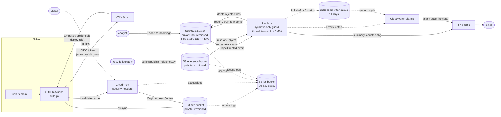

# AWS hosting

Infrastructure as code (AWS CDK, Python) that runs the dashboard on AWS:

- **Website:** S3 and CloudFront host the dashboard. GitHub Actions deploys it by signing in to AWS through OIDC, so no AWS keys are stored anywhere.
- **Data check:** uploading a discharge file to S3 triggers a Lambda function. It first refuses anything that isn't this project's synthetic data (the **synthetic-only guard**), then runs the same [data-quality checks](../outcomes/quality.py) as `scripts/check_data.py`, compares the file with a reference snapshot for **drift**, and emails the result.

- **Authenticated uploads:** reviewers you invite sign in on the AWS copy's `/upload.html` page, upload a synthetic sample batch, and see the check's counts-only result. See [Authenticated uploads](#authenticated-uploads) and [Reviewer access](#reviewer-access).

The GitHub Pages site keeps working on its own. This is a second, independent way to host the dashboard.

## Architecture



## Drift check

Each upload is compared, column by column, with a reference snapshot: the committed synthetic dataset. [dstoolkit](https://github.com/Dito-84/dstoolkit)'s `compare()` reports type changes (numbers arriving as text), distribution shift (the population stability index, PSI), more or fewer blanks, new codes or relabelled categories, and added or removed columns. Both files are read as delivered (`outcomes.load.load_raw`), before the dashboard's cleaning, which would otherwise hide some of these: `load()` reads a count sent as "Yes" as 0.

**What alerts** is decided in one place, [`drift_policy.py`](lambda/data_check/drift_policy.py):

| Finding | Result |
|---|---|
| A column removed, a type change, or blanks up or down by 10 percentage points or more | Alert |
| A major shift or new codes (PSI ≥ 0.25, or new values in ≥ 5% of rows) **and** an adjusted p-value under 0.01 | Alert |
| Moderate changes, added columns, and major shifts that could be chance (p ≥ 0.01) | Logged in the report and CloudWatch, no alert |
| Shift or new values in `readmit_provider_id` | Logged: provider IDs are expected to be new each time |

The p-value condition is there because "any major status alerts" would email on most uploads. Columns that are more than 96% blank hold a few dozen to a hundred or so values, and in batches with no real drift their PSI regularly crosses 0.25 by chance. With the condition, 120 fresh synthetic batches of 100 to 4,000 stays raised no alert, while each kind of real drift in the tests does.

**Counts only.** `compare()`'s `issues` text and `new_categories` list contain example values (a new hospital name, for instance), so [`drift.py`](lambda/data_check/drift.py) drops them before anything is written. Reports, logs and emails carry column names, statuses and numbers: PSI, adjusted p-value, blank shares and the number of new values.

**The reference** lives in its own versioned bucket. The function can read exactly one object, `reference/discharges.csv` (no wildcard), and has no write or delete permission there; the bucket policy also refuses writes from the function, in case one were ever added to its role. So an upload can never become the reference. It changes only when you run [`scripts/publish_reference.py`](../scripts/publish_reference.py), which publishes the committed synthetic CSV and nothing else, recording the git commit and SHA-256. Each report names the reference version it was compared with. The last 5 earlier versions are kept for a year. If the reference is missing, the drift check is skipped and the data check runs as before.

**Packaging.** SciPy (for the p-values) takes the package from 81 MB to 183 MB unzipped, inside Lambda's 250 MB limit, which covers the function and its layers together. A layer wouldn't raise it. dstoolkit's plotting library, matplotlib, would have pushed it to 259 MB. Since 0.15.1, dstoolkit imports matplotlib only when it draws, so it's installed from PyPI (`pandas-dstoolkit==0.17.0`, pinned by SHA-256) with `--no-deps`, and matplotlib is left out. A container image (up to 10 GB) was the alternative. It was rejected because it would add Docker to every deploy, and on an Intel Mac it would build the ARM64 image under emulation. If the function ever needs much more (scikit-learn to score a model, say), a container image built by GitHub Actions on an ARM64 runner is the next step.

## Synthetic-only guard

Real patient data must never be uploaded. That is a rule for people, and the guard is the safety net for the realistic accident: picking the real discharge export instead of the synthetic file.

**How it works.** The synthetic generator adds a `Synthetic Marker` column with one fixed value on every row. Before anything else, the function screens each upload with [`outcomes/synthetic_guard.py`](../outcomes/synthetic_guard.py). A file is refused if:

- it isn't a `.csv`. Synthetic data is always CSV, and Excel is the format the real export arrives in, so Excel files are no longer accepted in the intake bucket;
- it isn't UTF-8 text, or doesn't parse as CSV;
- the first row has no marker column (the real export has none, and has preamble rows above its headers);
- any row lacks the exact marker value;
- any row names a hospital other than the generator's three fictional ones.

A refused file is **deleted at once**, never loaded or checked, and its report says only `rejected: not a synthetic file: <reason>`. The reasons are fixed strings, so no value from the file is ever repeated. Every rejection is emailed, because it's the case you'd need to know about. The guard covers everything under `incoming/`, including your own command-line uploads. CI runs the same guard over every committed CSV (`scripts/check_no_real_data.py`).

**Why the screen doesn't use pandas.** The guard reads only the header and two columns, with Python's `csv` module, before pandas ever touches the file. It also has no dependencies, so CI can run it before installing anything.

**What it can't do.** It's not proof that a file is synthetic. Anyone can add the column to a real file on purpose. It reliably catches the accident, which is the risk that matters for a solo portfolio stack.

**Why the bucket is not versioned.** In a versioned bucket a delete only adds a delete marker, and the refused file would still be stored as a noncurrent version. A test fails if versioning is ever turned on.

**Failing safely.** An exception's message can quote a cell ("could not convert 'Hospital B'..."). So an unexpected error is logged, written to the report and re-raised **by its type only** (`data check failed (ValueError)`), with the original exception unchained so the Lambda runtime doesn't print it either. The error still counts as a Lambda error, so the `DataCheckErrors` alarm fires and Lambda retries as before.

**Website uploads** (`incoming/web/<user>/<id>.csv`, added with the upload page) are deleted as soon as they've been checked, whatever the result. Nothing needs them afterwards, so the file never sits in the bucket. The delete happens in a `finally` block, so a crash doesn't skip it, and a retry then finds nothing and keeps the error report. A 1-day lifecycle rule is the backstop for a check that never finishes (a timeout). Their counts-only reports go to `reports/web/<user>/<id>.csv.json` for 7 days, and they aren't emailed unless rejected: the page shows the result instead. Reports are now named after the full path under `incoming/`, so two users' files with the same name never collide.

## Authenticated uploads

An invited reviewer signs in, uploads a synthetic CSV straight to S3, and sees what the data check found. The upload goes into the same intake bucket and through the same Lambda as a command-line upload, so the synthetic-only guard, the quality checks and the drift check all apply. Nothing new touches the file's contents.

```mermaid
sequenceDiagram
    autonumber
    actor R as Reviewer (browser)
    participant CF as CloudFront<br/>/upload.html
    participant C as Cognito<br/>managed login
    participant API as API Gateway<br/>HTTP API + JWT authorizer
    participant P as Lambda<br/>presign
    participant D as DynamoDB<br/>daily limits
    participant S3 as S3 intake bucket<br/>incoming/web/&lt;sub&gt;/
    participant DC as Lambda<br/>data check
    participant Res as Lambda<br/>results

    R->>CF: open the page
    R->>R: pick a sample file; the page checks the marker locally
    R->>C: sign in (authorization code + PKCE)
    C-->>R: 30-minute tokens (refresh token discarded)
    R->>API: POST /uploads (Bearer token)
    API->>P: verified claims (sub)
    P->>D: count 1 upload (per user, all users)
    P-->>R: presigned POST: exact key, 1 B to 5 MB, text/csv, 5 minutes
    R->>S3: POST the file (S3 enforces the policy)
    S3->>DC: ObjectCreated
    DC->>DC: synthetic-only guard, quality checks, drift
    DC->>S3: counts-only report to reports/web/&lt;sub&gt;/; delete the upload
    loop every 3 s, up to 2 minutes
        R->>API: GET /uploads/{id}
        API->>Res: verified claims (sub)
        Res-->>R: 404 until ready, then the counts
    end
```

**Identity: Cognito, not IAM users or IAM Identity Center.** IAM users would make reviewers principals in the AWS account, with long-lived keys to rotate and leak. That's the wrong blast radius for "upload a demo CSV". IAM Identity Center is for workforce sign-in to AWS accounts and business apps: reviewers would see an AWS access portal, and its tokens aren't what an API Gateway JWT authorizer checks without extra token exchange. A Cognito user pool keeps reviewers at the application layer: they get JWTs that one API accepts, and no AWS permissions at all. The pool is on the Essentials tier, which includes managed login and is free under 10,000 monthly active users.

- **Invitation only.** Self sign-up is off; you create each account with [`scripts/demo_user.py`](../scripts/demo_user.py), and Cognito emails the reviewer a temporary password. Nobody shares a password.
- **Accounts expire.** Each has a `custom:valid_until` date. A **pre-authentication trigger** refuses sign-in after it, to the minute, and also refuses accounts with no valid date (fail closed). It needs no AWS permissions. The attribute is **immutable**: it's set when the account is created and can't be changed afterwards by anyone, so a reviewer can't extend their own expiry with their token. The app client can also write only `email`, an explicit list. An empty write list, which the first version used, means every attribute is writable in Cognito. The smoke test caught that on the first deploy, before any reviewer account existed. The first, mutable attribute (`custom:expires_at`) stays in the pool, unused, because Cognito can't remove a custom attribute.
- **Short tokens, no refresh.** Access and ID tokens last 30 minutes. Cognito doesn't run the pre-authentication trigger on refresh, so the page discards the refresh token (60 minutes, Cognito's minimum). Tokens are kept in page memory, never in browser storage. Disabling an account takes effect within 30 minutes, the life of a token already issued, because the JWT authorizer checks signatures, not revocation.
- **Sign-in methods and scopes.** The client allows SRP (Cognito's default password method), the admin method for the smoke test (which needs IAM credentials) and refresh. It requests the `openid` and `email` scopes, so it must be able to read both `email` and `email_verified`: without `email_verified`, Cognito answers every code exchange with `invalid_grant`, which is what broke the first browser sign-in. A test checks every scope's attributes are readable.
- **MFA is optional,** authenticator apps only. SMS would cost money and needs SNS set up for SMS.
- **The page** uses the authorization code flow with PKCE and a public client (no secret in the page), checks `state`, and allows connections, through its Content-Security-Policy, only to the API, the Cognito domain and the intake bucket. Results are shown with `textContent` only.

**Upload path: presigned POST, not presigned PUT.** A POST policy lets S3 itself enforce a size range (`content-length-range`, 1 byte to 5 MB), the exact key and the form's fields. A presigned PUT can't enforce a maximum size. It would need a signed exact Content-Length, which means trusting the client's stated size. PUT's advantages, a simpler client and multipart uploads for big files, don't matter under 5 MB. The `Content-Type: text/csv` condition is only a label the browser sends; the synthetic-only guard is the real check. The page also runs the guard's rules in the browser (a test checks it agrees with the Python guard), so a wrong file, such as the real export, is refused before any byte is sent.

**One bucket, prefix-scoped.** Website uploads use `incoming/web/<sub>/<uuid>.csv` in the existing intake bucket, so the existing trigger, lifecycle rules and check apply unchanged. The presign role can only sign `PutObject` under `incoming/web/*`, the POST policy fixes the exact key, and a bucket policy **denies writes to `incoming/web/` from any principal except the presign role**, whatever else is granted later. CORS allows `POST` only, and only from the CloudFront origin. CORS is a browser rule, not authentication: the signed policy is what protects the bucket.

**Limits.** HTTP APIs have no per-user usage plans, so the presign function counts uploads in DynamoDB: 20 per user per day and 200 for everyone per day, updated in one transaction (both or neither) and removed by TTL after two days. The all-users cap is what bounds the bill, since the data check is the expensive part. The stage also throttles every route (5 requests a second, bursts of 10) and `POST /uploads` harder (1 a second, bursts of 2).

**Results.** The results function reads `reports/web/<caller's sub>/<id>.csv.json`, with the sub taken from the verified token, never from the request, so one reviewer can't read another's result. It returns an explicit subset of the already counts-only report, so a field added to reports later doesn't reach the browser without a decision. It has no `s3:ListBucket`, so S3 answers AccessDenied for a result that doesn't exist yet. The function treats that as "not ready" (404).

**Monitoring.** Error alarms on the presign and results functions and on API 5xx responses, and a crash alarm on the pre-authentication trigger. Cognito refuses a sign-in only through an exception from the trigger, which Lambda counts as an error, so that alarm counts logged errors other than `AccountExpired` (a metric filter) and stays quiet when an expired account is refused. All of them email the alert topic like the data-check alarms (6 alarms in all, inside CloudWatch's free 10). API access logs record the route, status, caller's sub and source IP, kept a month. Website uploads that pass aren't emailed; rejected ones are.

**Why no AWS WAF.** WAF can't be attached to an HTTP API (it supports REST APIs, CloudFront, ALB, AppSync, Cognito user pools and a few others), so it couldn't protect the upload API itself. It would cost $5 a month for the web ACL plus $1 per rule, more than the whole stack's $5 budget. What it would add is covered here by invitation-only sign-in, expiring accounts, throttling, daily limits and the presigned policy, and CloudFront includes AWS Shield Standard. Worth revisiting only if sign-up were opened to the public.

**Cost at demo volume** (about 10 reviewers, 100 uploads and a few thousand API calls a month): Cognito $0 (free tier), API Gateway about $0.01 ($1.00 per million requests), the three functions and DynamoDB within the free tier or fractions of a cent, logs a few cents. Under $0.10 a month in all, and no new KMS key.

**What it doesn't do.** The marker can't prove a file is synthetic (see the guard). A refresh token taken from the browser's network log would work for up to 60 minutes after expiry or disabling. MFA isn't required. These fit an invitation-only demo of synthetic data; [What would change for real patient data](#what-would-change-for-real-patient-data) lists what wouldn't.

## Reviewer access

Run these from `infra/` with its virtual environment active and your own AWS profile. They read the pool ID from the stack's outputs.

```bash
python ../scripts/demo_user.py create reviewer@example.com --days 7
python ../scripts/demo_user.py list
python ../scripts/demo_user.py disable reviewer@example.com
python ../scripts/demo_user.py delete reviewer@example.com
```

- **create** makes the account, working until the end of its last day (UTC; `--days 1` means today only, up to 30). Cognito emails the reviewer the sign-in link and a temporary password, valid 7 days, from its default sender, which can land in spam. They choose their own password on first sign-in.
- **disable** stops sign-in at once and revokes the account's sessions. A token already issued lasts at most 30 minutes more.
- **To give someone more time,** delete the account and create it again: the end date can't be changed, by design.
- **delete** removes the account and its email address. Do this after a demo: reviewers' email addresses are personal data, and nothing else needs them.

There are no shared credentials anywhere: each reviewer has their own account, and their own password that nobody else sees.

## Design decisions

These are grouped by the four areas of the AWS Well-Architected Framework, which are also the four domains of the Solutions Architect – Associate exam.

**Secure**
- Every bucket blocks all public access, encrypts data at rest and refuses plain-HTTP requests.
- The site bucket can only be read by this one CloudFront distribution, through Origin Access Control. Visitors can't bypass the CDN.
- GitHub signs in to AWS through **OIDC**, so there are no long-lived access keys to leak or rotate. Only the `main` branch of this repository can assume the deploy role, and only for one hour at a time.
- **Least privilege, written out by hand:**
  - The deploy role can list, upload and delete files in the site bucket and clear the CloudFront cache. Nothing else.
  - The Lambda can read and delete under `incoming/` (rejected files, and website uploads once checked), write `reports/`, read the single reference object, publish to its topic and write its own logs. It can't delete anything outside `incoming/`. It uses no AWS managed policies.
- **Automated security review:** [cdk-nag](https://github.com/cdklabs/cdk-nag) runs the AWS Solutions rule pack on every synth and in CI. The few rules that don't apply are documented with reasons in [`nag.py`](dashboard_infra/nag.py). Any other finding fails the build.
- The data check's reports and emails contain only counts, column names and check names, never values from the file. Tests check this, including for a drifted file with relabelled and new values, a refused file, and a crash whose error message quotes values.
- The **synthetic-only guard** refuses and deletes anything that isn't marked synthetic data (see above).
- The alert topic is encrypted with a **customer managed KMS key**, rotated yearly. The AWS managed `alias/aws/sns` key can't be used here, because CloudWatch alarms can't publish to a topic encrypted with it and its policy can't be edited. The key policy lets CloudWatch use the key only for this account, and the topic policy accepts alarm messages only from this stack's two alarms.
- Failure alerts come from CloudWatch alarms, not from Lambda's failure records. Those records include the error message and could hold a value from the file; an alarm email says only which alarm fired.
- **Uploads from the website** need a Cognito sign-in from an account you created, which expires; see [Authenticated uploads](#authenticated-uploads).
- **The page itself** carries a Content-Security-Policy (built into the HTML, so the GitHub Pages copy has it too). It allows only the page's own script, by hash, and the chart library from jsDelivr, pinned by a subresource-integrity hash that CI checks against the CDN. A tampered library or an injected script won't run.

**Reliable**
- S3 and CloudFront are managed, multi-Availability-Zone services, and there are no servers to patch.
- Site versions are kept for 30 days, so a bad deploy can be rolled back.
- Buckets are kept if the stack is deleted, so data is never removed by accident.
- The drift reference is versioned and can only be replaced deliberately, so a bad upload can't change what "normal" means. If it's missing or the comparison fails, only the drift section is skipped.
- **A broken check is never silent.** S3 invokes the function asynchronously, so a crash or timeout sends no report email, and Lambda would drop the event after its retries. Instead, Lambda retries twice and then sends the event to an SQS **dead-letter queue**, kept 14 days. The queue holds the S3 event (bucket and file name), not the file. Two alarms email the alert topic: one on any function error (it may still succeed on retry), one when an event reaches the queue (it won't).

**Fast**
- CloudFront serves the site from edge locations, with compression and HTTP/3.
- The data check runs on Graviton (ARM64) Lambda with 1 GB of memory.

**Cost-effective**
- CloudFront uses the cheapest price class (North America and Europe edge locations).
- Lifecycle rules expire uploads after 7 days (website uploads after 1, as a backstop), reports and logs after 90 (website results after 7), and old site versions after 30.
- ARM64 Lambda costs about 20% less than x86 for the same work.
- AWS WAF was left out on purpose. It can't attach to the upload API (an HTTP API), and on CloudFront it would protect only static files. It would also cost more than everything else combined. See [Why no AWS WAF](#authenticated-uploads).
- An optional **AWS Budget** emails you before monthly spend passes $5.
- The customer managed key for the alert topic costs about $1 a month; the two alarms and the queue fit in the free tier (10 alarms, 1 million SQS requests).
- The drift check adds a few seconds per upload at 1 GB on ARM64 (about 1.5 s on a laptop, including loading SciPy; roughly $0.00005 per upload) and a 0.4 MB reference file in S3. The 2-minute timeout and 1 GB memory are unchanged. Both are a fraction of a cent a month, well inside the budget.

At portfolio traffic, almost everything here stays within AWS's free tier: CloudFront's 1 TB a month, Lambda's 1 million requests, the first 1,000 SNS emails, 10 alarms, 1 million SQS requests and the first two budgets. S3 storage of a few megabytes costs a fraction of a cent. The one fixed cost is the alert topic's KMS key, about $1 a month.

## What would change for real patient data

This stack only ever handles the **synthetic** dataset. Real patient data would need more than this code:

- A signed **Business Associate Addendum (BAA)** with AWS, through AWS Artifact, before any patient data is uploaded. Patient data may only go into HIPAA-eligible services; the ones that would touch it here (S3, Lambda, SNS and CloudWatch Logs) are all on that list.
- Encryption with a **customer managed KMS key** instead of S3-managed keys, so access to the data can be audited and revoked separately.
- **CloudTrail data events** on the intake bucket, to record who read or wrote each file.
- Uploads restricted to the organization's own staff, signing in through its identity provider (SAML or OIDC federation into Cognito, or IAM Identity Center), with **MFA required**, Cognito's threat protection (Plus tier), and AWS WAF in front of a REST API, rather than invited reviewers.
- No browser-side screening of patient files and no synthetic-only guard, but the same counts-only reporting, which is what makes the results safe to show.

## Deploy it

You need an AWS account, **Python 3.12 or newer** (the Lambda's pinned numpy and pandas need it; the app stops with a clear message on anything older), **Node.js 20 or newer** and the AWS CLI.

1. **Install the tools.** With [Homebrew](https://brew.sh):
   ```bash
   brew install python awscli node
   ```
   Without Homebrew, Anaconda can supply Python and Node in their own environment (install the AWS CLI from aws.amazon.com/cli):
   ```bash
   conda create -y -n cdk -c conda-forge python=3.13 nodejs=22
   export PATH="$(conda info --base)/envs/cdk/bin:$PATH"   # in each new Terminal window
   ```
   Check with `python3 --version` and `node --version` before creating `.venv` below.
2. **Sign in.** In the AWS console, create a user in **IAM Identity Center** with the `AdministratorAccess` permission set. Don't use the root user. Then sign in from the terminal:
   ```bash
   aws configure sso
   ```
   Choose `us-east-1` as the region and `dashboard` as the profile name.
3. **Deploy the stack:**
   ```bash
   cd infra
   python3 -m venv .venv && source .venv/bin/activate
   pip install -r requirements.txt
   export AWS_PROFILE=dashboard
   npx aws-cdk@2 bootstrap                                   # once per account and region
   npx aws-cdk@2 deploy HipKneeDashboard -c alert_email=you@example.com   # required: synth stops without it
   ```
   If the deploy fails with *"Provider with url https://token.actions.githubusercontent.com already exists"*, your account already trusts GitHub. Add `-c existing_oidc_provider_arn=arn:aws:iam::<account id>:oidc-provider/token.actions.githubusercontent.com` and run the deploy again.
4. **Confirm the email.** AWS sends a subscription confirmation; click the link in it.
5. **Connect GitHub.**
   - In the repository, open **Settings → Secrets and variables → Actions → Variables** and add three variables, using the values from the deploy output:

     | Variable | Value from the deploy output |
     |---|---|
     | `AWS_DEPLOY_ROLE_ARN` | `DeployRoleArn` |
     | `AWS_SITE_BUCKET` | `SiteBucketName` |
     | `AWS_DISTRIBUTION_ID` | `DistributionId` |

   - Then go to **Actions → Deploy to AWS → Run workflow**. After that, every push to `main` deploys automatically.
   - The site is at the `SiteUrl` output.
6. **Publish the drift reference** (once, and again only when you decide the synthetic dataset should be the new normal, or when its columns change, as they did when the marker column was added):
   ```bash
   python ../scripts/publish_reference.py --bucket <ReferenceBucketName> --dry-run   # check, then run without --dry-run
   ```
7. **Check the failure alerts** (optional). This sets an alarm to ALARM by hand, which should email you within a minute, and CloudWatch sets it back on its next evaluation:
   ```bash
   aws cloudwatch describe-alarms --alarm-name-prefix HipKneeDashboard --query "MetricAlarms[].AlarmName"
   aws cloudwatch set-alarm-state --alarm-name <DataCheckErrors alarm name> --state-value ALARM --state-reason "Testing the alert email"
   ```
8. **Turn on the upload page** (after any deploy that creates the upload resources):
   - Add four more repository variables from the deploy output:

     | Variable | Value from the deploy output |
     |---|---|
     | `UPLOAD_API_URL` | `UploadApiUrl` |
     | `UPLOAD_AUTH_DOMAIN` | `AuthDomain` |
     | `UPLOAD_CLIENT_ID` | `UserPoolClientId` |
     | `UPLOAD_BUCKET` | `IntakeBucketName` |

   - Run **Actions → Deploy to AWS → Run workflow**. The build adds `upload.html` and its sample batches only when all four are set. The GitHub Pages copy never has them.
   - Run the end-to-end smoke test. It creates a throwaway account (no email is sent), checks every refusal path against the live stack, then deletes the account:
     ```bash
     python ../scripts/smoke_upload.py
     ```
   - Invite a reviewer (see [Reviewer access](#reviewer-access)).
9. **Try the data check:**
   ```bash
   aws s3 cp ../data/synthetic_discharges.csv s3://<IntakeBucketName>/incoming/
   # a few seconds later you'll get an email; the full report is here:
   aws s3 cp s3://<IntakeBucketName>/reports/synthetic_discharges.csv.json -
   ```
   To see the guard refuse a file, upload any CSV without the marker column. It's reported as `rejected` and deleted:
   ```bash
   printf 'Hospital,Measure\nHospital A,x\n' > /tmp/no-marker.csv
   aws s3 cp /tmp/no-marker.csv s3://<IntakeBucketName>/incoming/
   aws s3 ls s3://<IntakeBucketName>/incoming/no-marker.csv   # nothing: already deleted
   ```

### Redeploying after changes

The app has **two stacks**, so every `cdk` command names the one it means:

| Stack | What it holds | Deployed by |
|---|---|---|
| `HipKneeDashboard` | The site, the data check, authenticated uploads | CI, after you approve (see below) |
| `HipKneeDashboardCi` | The GitHub OIDC roles CI uses: Diff, Deploy, Smoke | You, rarely, from your own machine |

Merging to `main` deploys the website straight away. If the merge also changed the main stack, or the code its Lambdas bundle, the **Deploy stack** workflow starts and waits for your approval (below). Deploying `HipKneeDashboard` from your own machine is now the break-glass route, for when CI itself is broken: run `cdk diff HipKneeDashboard`, then `cdk deploy HipKneeDashboard`, with the same `-c` options as your first deploy. They aren't saved in `cdk.json`, so leaving one out removes the email and budget alerts.

Both stacks have **termination protection**: `cdk destroy` fails until you turn it off.

### Deploying from CI

The design: a pull request shows what would change; merging changes nothing in AWS until you approve; the deploy checks the change set before applying it, then runs the smoke test. No AWS keys are stored in GitHub.

**`HipKneeDashboardCi`** ([`ci.py`](dashboard_infra/ci.py)) holds three GitHub OIDC roles, each trusted for this repository in one context only:

| Role | Who can assume it | What it can do |
|---|---|---|
| Diff | Pull requests, and the plan job on `main` | Read these two stacks' descriptions and templates; nothing else |
| Deploy | Only jobs in the GitHub `production` environment, which waits for a required reviewer | Assume CDK's bootstrap deploy and file-publishing roles; inspect and execute change sets on `HipKneeDashboard` |
| Smoke | The same environment | What [`smoke_upload.py`](../scripts/smoke_upload.py) needs: throwaway-account admin calls on the user pool, reading the stack's outputs, checking website uploads were deleted |

Design decisions:

- **A separate stack.** If these roles lived in the stack CI deploys, one bad change could lock CI out of deploying the fix. This one changes rarely, and you deploy it yourself.
- **Not CDK's lookup role for diffs.** It carries `ReadOnlyAccess`, which includes `s3:GetObject` on every bucket, and a pull request's diff runs that branch's code. The Diff role reads two templates and nothing else. Pull requests from forks and Dependabot can't get OIDC tokens, so their diff is skipped.
- **Template diffs before approval, and a replacement guard after.** A full `cdk diff` creates a change set, which needs the deploy role; granting that before approval would undermine the gate. So pull requests and the plan job compare templates (`--method=template`), and the deploy job creates the change set, fails if it would replace a stateful resource, and only then executes it.
- **A pinned toolchain.** Approving a deploy approves whatever the job runs, with CDK's deploy role. So the job runs only pinned code: the CDK CLI from [`package-lock.json`](package-lock.json) (`npm ci`, then `npx cdk`), exact Python versions from [`requirements.txt`](requirements.txt) (compiled from `requirements.in`), and actions pinned by commit SHA. The plan and the change set are built from the same versions, and Dependabot proposes updates as reviewable pull requests.
- **No deploy without alerts.** `alert_email` isn't in `cdk.json` (the repository is public), and a synth without it would remove the email subscription and the budget. [`settings.py`](dashboard_infra/settings.py) stops the synth instead, unless it's marked `-c allow_no_alerts=true` (CI's synth check, which is never deployed).
- **Public by default.** On a public repository, pull-request comments and Actions logs are public too. The workflow masks the account ID and removes it and every email address ([`scrub_diff.py`](../scripts/scrub_diff.py)) before posting; the alert email is a GitHub **secret**, which is also masked in logs.

**[`stack-diff.yml`](../.github/workflows/stack-diff.yml)** posts the diff of both stacks as a comment on every pull request that touches the stacks or the code the data-check Lambda bundles, and updates it on each push. It skips itself until the `AWS_DIFF_ROLE_ARN` variable is set.

**[`deploy-stack.yml`](../.github/workflows/deploy-stack.yml)** runs on merges to `main` that change the main stack or its Lambdas' code:

1. **Plan** (no approval needed): the template diff, with the Diff role, written to the run's summary page so you can read it before approving. It warns if the merge also changed `HipKneeDashboardCi`, which you deploy yourself.
2. **Deploy** waits in the `production` environment until you approve it (**Actions → Deploy stack → the run → Review deployments**). Then it:
   - creates a CloudFormation change set through CDK's deploy role. Nothing changes yet.
   - runs the **replacement guard** ([`check_change_set.py`](../scripts/check_change_set.py)). It refuses, and deletes the change set, if a bucket, the user pool or its domain, the limits table, the KMS key, the CloudFront distribution or the dead-letter queue would be replaced, might be replaced, or would be removed. The same goes for resources whose loss breaks something without an error: the alert topic, its email subscription and the budget (alerts would stop), the GitHub OIDC provider (every CI role trusts it), and the upload page's app client and API (new IDs would leave the `UPLOAD_*` variables stale). If CloudFormation found nothing to change (it marks such a change set FAILED, not deleted), it removes it, says so and skips the next step. A change set that failed for any other reason fails the job, with the reason.
   - executes the change set and waits for the update to finish. A failure rolls back on its own.
   - runs the **smoke test** with the Smoke role and adds its results to the summary.

For a deliberate replacement, run **Deploy stack** by hand (**Run workflow**) with **Allow replacement** ticked. The guard then reports the replacement instead of refusing it, and the approval gate still applies. Stack deploys run one at a time, in their own concurrency group. It's separate from the website deploy's, because a run waiting for approval would otherwise hold up the website, and with a second merge GitHub would cancel the waiting website deploy.

**One-time setup** (after deploying `HipKneeDashboardCi`):

1. `npx aws-cdk@2 deploy HipKneeDashboardCi`, then note its three outputs.
2. Under **Settings → Environments**, create `production`: add yourself as a **required reviewer**, and limit deployment branches to `main`.
3. Under **Settings → Secrets and variables → Actions**, add the secret `ALERT_EMAIL`, and the variables `AWS_DIFF_ROLE_ARN`, `AWS_STACK_DEPLOY_ROLE_ARN` and `AWS_SMOKE_ROLE_ARN` from the outputs.

**Known trade-off:** CDK's bootstrap CloudFormation execution role has `AdministratorAccess` by default, so approving a deploy approves admin-level changes, exactly as a deploy from your own machine does. The approval gate, `main`-only trust and the branch ruleset contain it. Scoping that role is a separate phase; [`docs/well-architected.md`](../docs/well-architected.md) explains why and how.

### Using this with another repository

`cdk.json` names the repository allowed to deploy, together with GitHub's permanent owner and repository IDs. Repositories created after July 15, 2026 send these IDs when they sign in to AWS, in the form `repo:owner@<owner id>/name@<repo id>:ref:refs/heads/main`. To use the stack with a different repository, look up both IDs:

```bash
curl -s https://api.github.com/repos/<owner>/<name> | grep -E '"id"' | head -2   # repository ID, then owner ID
```

### Tear it down

```bash
npx aws-cdk@2 destroy HipKneeDashboardCi HipKneeDashboard
```

Both stacks have termination protection, so turn it off first, in the CloudFormation console (**Stack actions → Edit termination protection**). The four buckets are kept on purpose, and so is the user pool, which has deletion protection on. To remove the pool, turn deletion protection off in the Cognito console first. To remove them, open each one in the S3 console, choose **Empty**, then **Delete**.

## Tests

```bash
pip install -r requirements-dev.txt
pytest tests            # template and security checks, plus the Lambda logic against synthetic data (seconds)
pytest tests --bundle   # also builds the real Lambda package and runs it in a clean interpreter
npx aws-cdk@2 synth     # full CloudFormation template; fails on any unexplained cdk-nag finding
```

CI runs all three on every pull request. None of them needs an AWS account.

## Files

| Path | Purpose |
|---|---|
| `app.py`, `cdk.json` | CDK app and its settings (repository, branch, region) |
| `dashboard_infra/stack.py` | Buckets (including the drift reference), CloudFront, OIDC deploy role, Lambda with its dead-letter queue and alarms, SNS with its key, budget |
| `dashboard_infra/bundling.py` | Builds the Lambda package: pip downloads pandas, NumPy and SciPy for Linux ARM64, so no Docker is needed; dstoolkit is added without matplotlib |
| `dashboard_infra/nag.py` | The documented exceptions to the cdk-nag security rules |
| `dashboard_infra/ci.py` | The CI stack: GitHub OIDC roles for diffs, approved deploys and smoke tests |
| `../scripts/scrub_diff.py` | Removes the account ID and email addresses from `cdk diff` output before it's posted on the public repository |
| `dashboard_infra/uploads.py` | Authenticated uploads: Cognito user pool and managed login, HTTP API with a JWT authorizer, presign and results functions, DynamoDB daily limits, bucket CORS and policy, alarms |
| `lambda/upload_api/` | `presign.py` (POST /uploads), `results.py` (GET /uploads/{id}), `common.py` |
| `lambda/pre_auth/handler.py` | Cognito pre-authentication trigger: refuses expired demo accounts |
| `../scripts/demo_user.py` | Create, list, disable and delete time-limited reviewer accounts |
| `../scripts/smoke_upload.py` | End-to-end check of the deployed upload path, including every refusal |
| `../dashboard/upload.html`, `../outcomes/samples.py` | The upload page and its four sample batches (built only for the AWS copy) |
| `lambda/data_check/handler.py` | The data-check function: synthetic-only guard first, then the checks; it reuses the dashboard's `outcomes` package |
| `../outcomes/synthetic_guard.py` | The synthetic-only guard (standard library only), shared with CI's no-real-data check |
| `lambda/data_check/drift.py`, `drift_policy.py` | The drift comparison (counts only) and the one place that decides what alerts |
| `../scripts/publish_reference.py` | Publishes the committed synthetic dataset as the drift reference |
| `../.github/workflows/deploy-aws.yml` | Builds the site and deploys it through OIDC |
