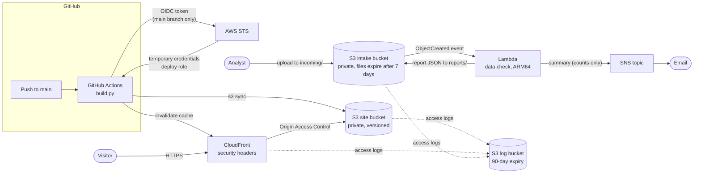

# AWS hosting

Infrastructure as code (AWS CDK, Python) that runs the dashboard on AWS:

- **Website:** S3 and CloudFront host the dashboard. GitHub Actions deploys it by signing in to AWS through OIDC, so no AWS keys are stored anywhere.
- **Data check:** uploading a discharge file to S3 triggers a Lambda function. It runs the same [data-quality checks](../outcomes/quality.py) as `scripts/check_data.py` and emails the result.

The GitHub Pages site keeps working on its own. This is a second, independent way to host the dashboard.

## Architecture



## Design decisions

These are grouped by the four areas of the AWS Well-Architected Framework, which are also the four domains of the Solutions Architect – Associate exam.

**Secure**
- Every bucket blocks all public access, encrypts data at rest and refuses plain-HTTP requests.
- The site bucket can only be read by this one CloudFront distribution, through Origin Access Control. Visitors can't bypass the CDN.
- GitHub signs in to AWS through **OIDC**, so there are no long-lived access keys to leak or rotate. Only the `main` branch of this repository can assume the deploy role, and only for one hour at a time.
- **Least privilege, written out by hand:**
  - The deploy role can list, upload and delete files in the site bucket and clear the CloudFront cache. Nothing else.
  - The Lambda can read `incoming/`, write `reports/`, publish to its topic and write its own logs. It uses no AWS managed policies.
- **Automated security review:** [cdk-nag](https://github.com/cdklabs/cdk-nag) runs the AWS Solutions rule pack on every synth and in CI. The few rules that don't apply are documented with reasons in [`nag.py`](dashboard_infra/nag.py). Any other finding fails the build.
- The data check's reports and emails contain only counts and check names, never values from the file. A test checks this.
- **The page itself** carries a Content-Security-Policy (built into the HTML, so the GitHub Pages copy has it too). It allows only the page's own script, by hash, and the chart library from jsDelivr, pinned by a subresource-integrity hash that CI checks against the CDN. A tampered library or an injected script won't run.

**Reliable**
- S3 and CloudFront are managed, multi-Availability-Zone services, and there are no servers to patch.
- Site versions are kept for 30 days, so a bad deploy can be rolled back.
- Buckets are kept if the stack is deleted, so data is never removed by accident.

**Fast**
- CloudFront serves the site from edge locations, with compression and HTTP/3.
- The data check runs on Graviton (ARM64) Lambda with 1 GB of memory.

**Cost-effective**
- CloudFront uses the cheapest price class (North America and Europe edge locations).
- Lifecycle rules expire uploads after 7 days, reports and logs after 90, and old site versions after 30.
- ARM64 Lambda costs about 20% less than x86 for the same work.
- AWS WAF was left out on purpose: the site is static, with nothing to log in to or submit, and WAF would cost more than everything else combined.
- An optional **AWS Budget** emails you before monthly spend passes $5.

At portfolio traffic, everything here should stay within AWS's free tier: CloudFront's 1 TB a month, Lambda's 1 million requests, the first 1,000 SNS emails and the first two budgets. S3 storage of a few megabytes costs a fraction of a cent.

## What would change for real patient data

This stack only ever handles the **synthetic** dataset. Real patient data would need more than this code:

- A signed **Business Associate Addendum (BAA)** with AWS, through AWS Artifact, before any patient data is uploaded. Patient data may only go into HIPAA-eligible services; the ones that would touch it here (S3, Lambda, SNS and CloudWatch Logs) are all on that list.
- Encryption with a **customer managed KMS key** instead of S3-managed keys, so access to the data can be audited and revoked separately.
- **CloudTrail data events** on the intake bucket, to record who read or wrote each file.
- Uploads restricted to known users, for example through IAM Identity Center groups or VPC endpoints, rather than anyone with access to the account.

## Deploy it

You need an AWS account, plus [Homebrew](https://brew.sh) on a Mac.

1. **Install the tools:**
   ```bash
   brew install awscli node
   ```
2. **Sign in.** In the AWS console, create a user in **IAM Identity Center** with the `AdministratorAccess` permission set. Don't use the root user. Then sign in from the terminal:
   ```bash
   aws configure sso
   ```
   Choose `us-east-1` as the region and `dashboard` as the profile name.
3. **Deploy the stack:**
   ```bash
   cd infra
   python3 -m venv .venv && source .venv/bin/activate
   pip install -r requirements.txt
   export AWS_PROFILE=dashboard
   npx aws-cdk@2 bootstrap                                   # once per account and region
   npx aws-cdk@2 deploy -c alert_email=you@example.com       # omit -c ... to skip email and budget alerts
   ```
   If the deploy fails with *"Provider with url https://token.actions.githubusercontent.com already exists"*, your account already trusts GitHub. Add `-c existing_oidc_provider_arn=arn:aws:iam::<account id>:oidc-provider/token.actions.githubusercontent.com` and run the deploy again.
4. **Confirm the email.** AWS sends a subscription confirmation; click the link in it.
5. **Connect GitHub.**
   - In the repository, open **Settings → Secrets and variables → Actions → Variables** and add three variables, using the values from the deploy output:

     | Variable | Value from the deploy output |
     |---|---|
     | `AWS_DEPLOY_ROLE_ARN` | `DeployRoleArn` |
     | `AWS_SITE_BUCKET` | `SiteBucketName` |
     | `AWS_DISTRIBUTION_ID` | `DistributionId` |

   - Then go to **Actions → Deploy to AWS → Run workflow**. After that, every push to `main` deploys automatically.
   - The site is at the `SiteUrl` output.
6. **Try the data check:**
   ```bash
   aws s3 cp ../data/synthetic_discharges.csv s3://<IntakeBucketName>/incoming/
   # a few seconds later you'll get an email; the full report is here:
   aws s3 cp s3://<IntakeBucketName>/reports/synthetic_discharges.csv.json -
   ```

### Redeploying after changes

Merging to `main` deploys the website only. The stack, including the data-check Lambda, changes only when you run `cdk deploy`. So a workflow ([`lambda-redeploy-reminder.yml`](../.github/workflows/lambda-redeploy-reminder.yml)) comments on any pull request that changes what the deploy would ship: the stack definition, the Lambda's handler or requirements, or the `outcomes/` code it bundles. After merging one of those, run `cdk diff` and then `cdk deploy` with the same `-c` options as your first deploy. They aren't saved in `cdk.json`, so leaving one out removes the email and budget alerts.

### Using this with another repository

`cdk.json` names the repository allowed to deploy, together with GitHub's permanent owner and repository IDs. Repositories created after July 15, 2026 send these IDs when they sign in to AWS, in the form `repo:owner@<owner id>/name@<repo id>:ref:refs/heads/main`. To use the stack with a different repository, look up both IDs:

```bash
curl -s https://api.github.com/repos/<owner>/<name> | grep -E '"id"' | head -2   # repository ID, then owner ID
```

### Tear it down

```bash
npx aws-cdk@2 destroy
```

The three buckets are kept on purpose. To remove them, open each one in the S3 console, choose **Empty**, then **Delete**.

## Tests

```bash
pip install -r requirements-dev.txt
pytest tests            # template and security checks, plus the Lambda logic against synthetic data (seconds)
pytest tests --bundle   # also builds the real Lambda package and runs it in a clean interpreter
npx aws-cdk@2 synth     # full CloudFormation template; fails on any unexplained cdk-nag finding
```

CI runs all three on every pull request. None of them needs an AWS account.

## Files

| Path | Purpose |
|---|---|
| `app.py`, `cdk.json` | CDK app and its settings (repository, branch, region) |
| `dashboard_infra/stack.py` | Buckets, CloudFront, OIDC deploy role, Lambda, SNS, budget |
| `dashboard_infra/bundling.py` | Builds the Lambda package: pip downloads pandas for Linux ARM64, so no Docker is needed |
| `dashboard_infra/nag.py` | The documented exceptions to the cdk-nag security rules |
| `lambda/data_check/handler.py` | The data-check function; it reuses the dashboard's `outcomes` package |
| `../.github/workflows/deploy-aws.yml` | Builds the site and deploys it through OIDC |
